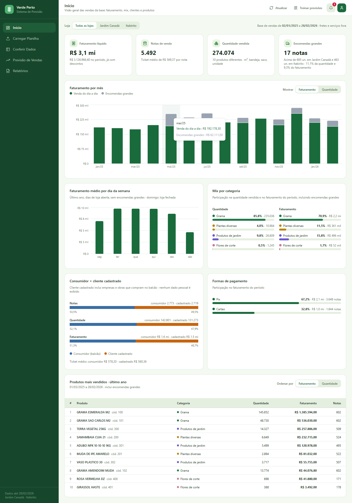
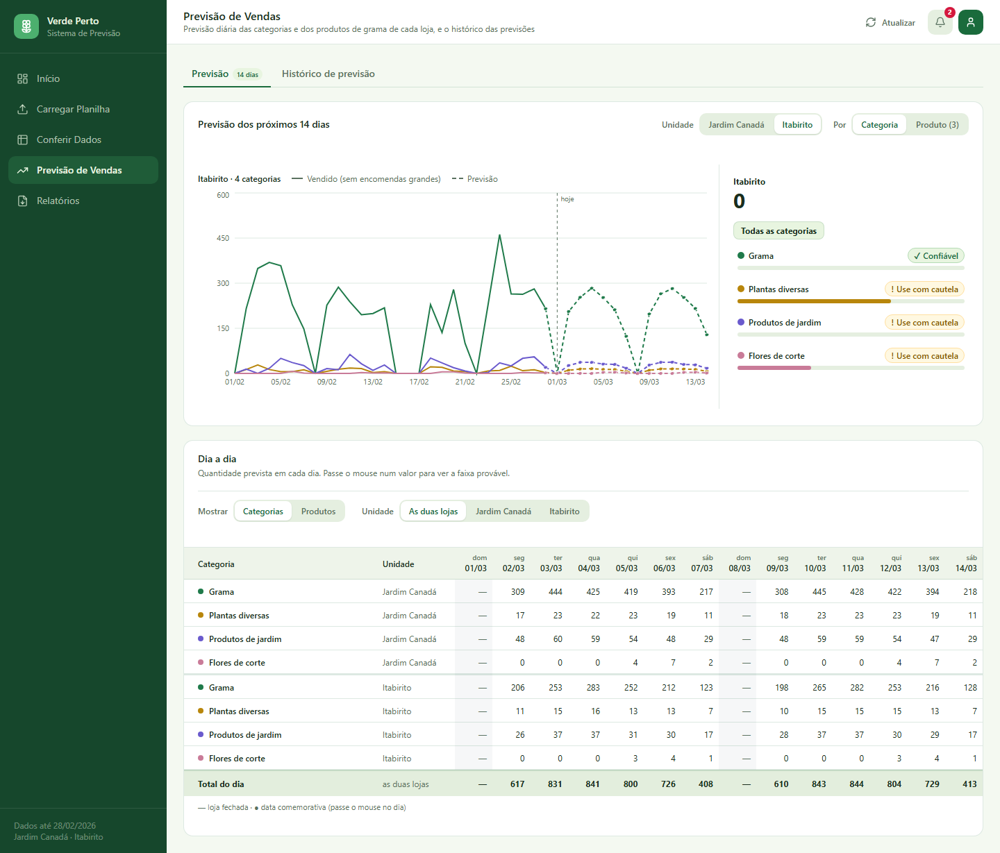
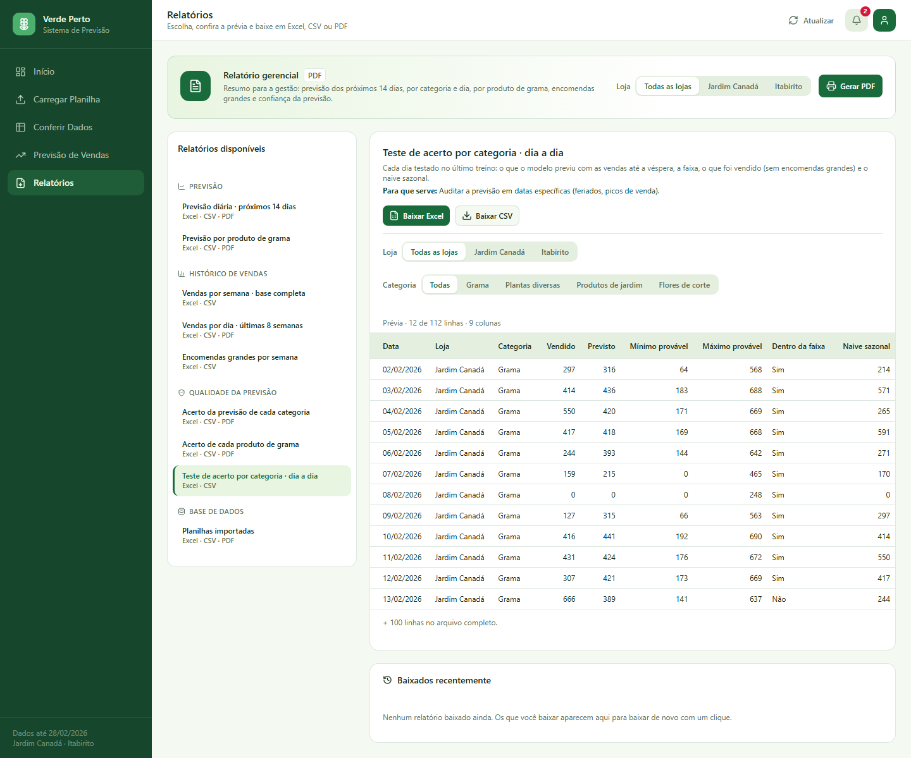
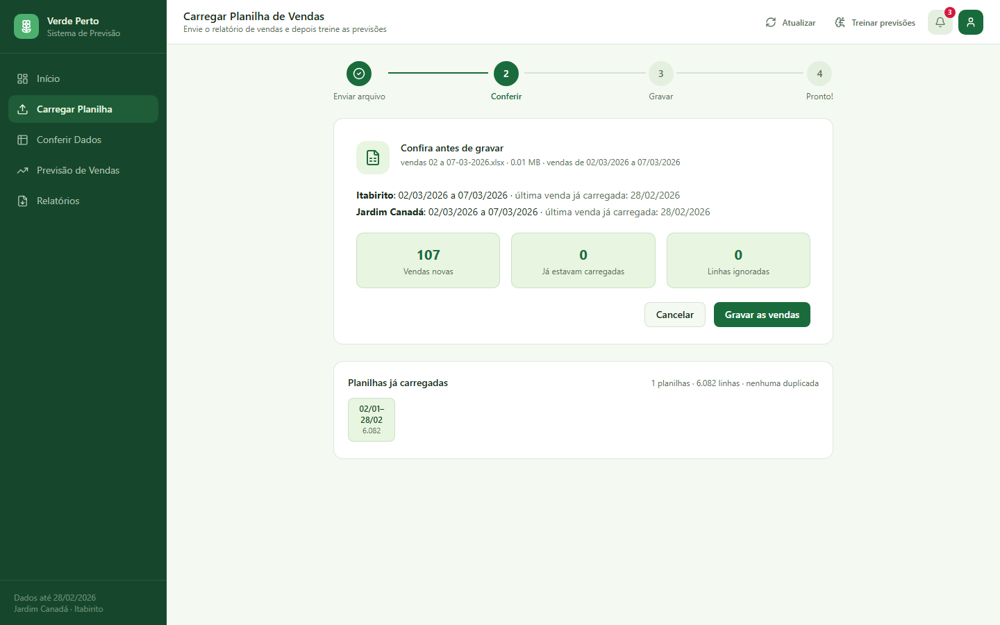

# Previsão de demanda diária para rede de floriculturas (TCC)

Sistema web que prevê, dia a dia, quanto cada loja de uma rede de floriculturas e garden center vai vender por categoria e por produto de grama, com API em FastAPI, modelos SARIMAX e dashboard em React. Trabalho de Conclusão de Curso em Ciência da Computação (Centro Universitário Dom Helder, 2026).

## Problema que resolve e para quem

Duas lojas de uma floricultura e garden center em Minas Gerais trabalham com produtos perecíveis (grama, plantas, flores de corte) e precisavam saber quanto vão vender em cada dia para planejar as compras. A base usada no projeto tem mais de 324 mil transações e mais de 5.100 SKUs, de jan/2024 a fev/2026, nas 2 lojas.

O sistema é voltado à gestão das lojas: a gestora envia as planilhas de vendas, o sistema confere os dados, treina os modelos e mostra a previsão e a confiança de cada série. A decisão de compra continua com a loja; o sistema informa quanto deve ser vendido.

O que o sistema entrega:

- Previsão diária de 91 dias para cada uma das 4 categorias e para cada produto de grama, por loja, com horizonte escolhido na tela (de 14 a 91 dias) e intervalo de confiança de 95% ([ADR-017](docs/prediction/ADR-017-previsao-por-categoria-e-grama.md), [ADR-021](docs/prediction/ADR-021-horizonte-de-previsao-selecionavel.md)).
- Validação walk-forward (origem móvel) antes de gravar cada previsão, com escolha da diferenciação de cada série pelo próprio walk-forward ([ADR-020](docs/prediction/ADR-020-diferenciacao-por-serie.md)) e janela de treino de 545 dias ([ADR-022](docs/prediction/ADR-022-janela-de-treino-de-545-dias.md)).
- Fator multiplicativo para datas comemorativas, que reduziu em 40–45% o erro da semana de Flores de corte ([ADR-019](docs/prediction/ADR-019-fator-das-datas-comemorativas.md), [doc 08](docs/prediction/08-fator_datas_comemorativas.md)).
- Histórico das previsões congelado dia a dia, importação de planilhas com conferência antes de gravar, relatórios em Excel, CSV e PDF, e perfis de acesso (administração e consulta) com JWT.

## Tecnologias utilizadas

- **Back-end:** Python, FastAPI, SQLAlchemy 2.0, PostgreSQL (Neon) e SQLite, autenticação JWT (python-jose + bcrypt), pydantic-settings.
- **Modelagem:** statsmodels (SARIMAX), Pandas, NumPy, SciPy; scikit-learn e outros modelos apenas nos experimentos (`ia-predictor/training_scripts/`). Metodologia CRISP-DM.
- **Front-end:** React 18, TypeScript, Vite, Recharts, MUI; cliente TypeScript gerado a partir de `ia-predictor/openapi.yaml`.
- **Testes:** pytest (unitários e de integração) e Playwright (ponta a ponta).
- **Publicação:** Docker, Render + Vercel, Azure Container Apps.

## Como executar

Pré-requisitos: Python 3.11 ou superior, Node.js com npm e Git.

> A base real de vendas da empresa parceira **não** está no repositório. Os testes de ponta a ponta montam sozinhos uma base sintética; para usar dados reais é preciso ter as planilhas de vendas.

**1. API (FastAPI)** — a partir da raiz do repositório:

```bash
pip install -r ia-predictor/requirements.txt

# copie o exemplo e troque JWT_SECRET_KEY (32+ caracteres) e as duas senhas (8+);
# a API não sobe com os valores de exemplo
cp ia-predictor/.env.example ia-predictor/.env

uvicorn backend.main:app --reload --app-dir ia-predictor
# documentação interativa: http://localhost:8000/docs
```

Os usuários iniciais (administração e consulta) são criados na subida da API a partir de `ADMIN_*` e `VIEWER_*` do `.env`.

**2. Dashboard (React)** — em outro terminal:

```bash
cd app-react
npm ci
cp .env.example .env      # VITE_API_URL=http://localhost:8000
npm run dev
```

**3. Dados e treino** (com as planilhas de vendas), a partir de `ia-predictor/`:

```bash
python -m training_scripts.preprocessing.run_all      # pré-processamento (etapas 1–7)
python -m backend.scripts.carga_inicial               # carga inicial do banco do DATABASE_URL
python -m backend.scripts.treinar_previsoes --workers 8
```

**4. Testes**

```bash
pytest ia-predictor/tests/unit/ -v
pytest ia-predictor/tests/integration/ -v

cd app-react
npm run e2e:instalar   # uma vez: Chromium do Playwright
npm run e2e            # sobe API e front com base sintética e tira as fotos das telas
```

Publicação: passo a passo em [`deploy/README.md`](deploy/README.md) (Render + Vercel) e [`deploy/azure/README.md`](deploy/azure/README.md) (Azure Container Apps).

## Minha contribuição

Projeto em dupla: Felipe Gurgel Araújo e Daniel Nunes da Silva.

- **Felipe Gurgel Araújo:** pré-processamento e ETL das planilhas, análise exploratória, experimentos e modelagem SARIMAX, back-end FastAPI (API, autenticação, serviços e banco), maior parte do dashboard React e documentação técnica (SPECS, ADRs e relatórios de modelagem).
- **Daniel Nunes da Silva:** publicação da API e do front em Render/Vercel, Google Cloud Run e Azure Container Apps, testes de ponta a ponta com Playwright, parte das telas React e ajustes no back-end.

## Demonstração

Telas capturadas pelos testes de ponta a ponta (Playwright), sobre base sintética.

**Início — visão geral das vendas**



**Previsão de vendas por categoria, com a tabela dia a dia**



**Relatório de teste de acerto (previsto x vendido, faixa provável e naive sazonal)**



**Importação de planilha com conferência antes de gravar**



## Estrutura

```text
ia-predictor/        API FastAPI (backend/), experimentos (training_scripts/), testes e openapi.yaml
app-react/           dashboard React + testes Playwright (e2e/)
deploy/              publicação em Render/Vercel e Azure Container Apps
docs/                ADRs e relatórios de modelagem, banco, back-end e front-end
specs/               especificação, plano e tarefas
CLAUDE.md, SPECS.md  guia de desenvolvimento e referência técnica
```

## Documentação

- Índice da documentação e lista de ADRs: [`docs/README.md`](docs/README.md)
- Como o sistema treina, guarda e mostra a previsão: [`docs/prediction/07-previsao_14_dias_e_historico.md`](docs/prediction/07-previsao_14_dias_e_historico.md)
- Análise exploratória: [`docs/prediction/00-eda_report.md`](docs/prediction/00-eda_report.md)
- Referência técnica completa: [`SPECS.md`](SPECS.md) · guia de desenvolvimento: [`CLAUDE.md`](CLAUDE.md)
