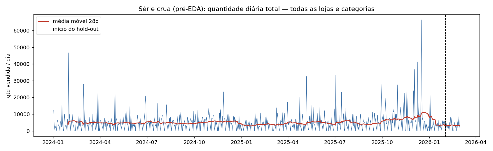
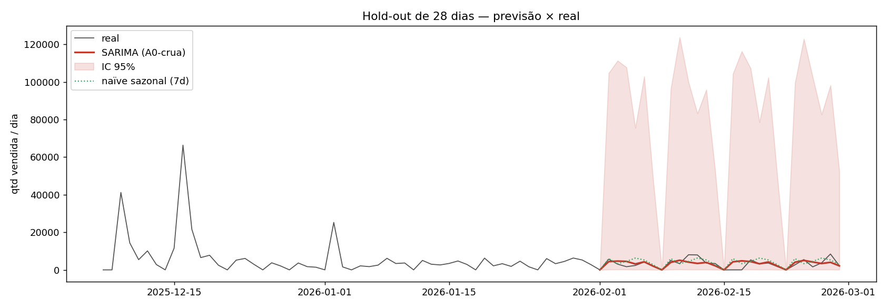
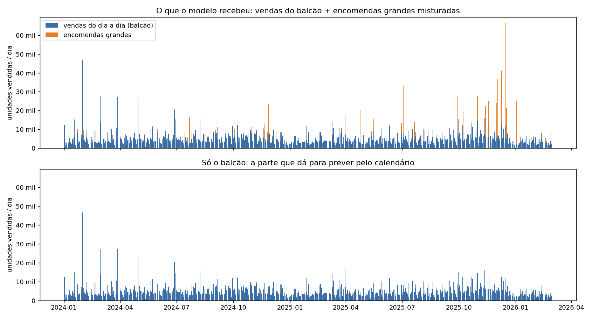
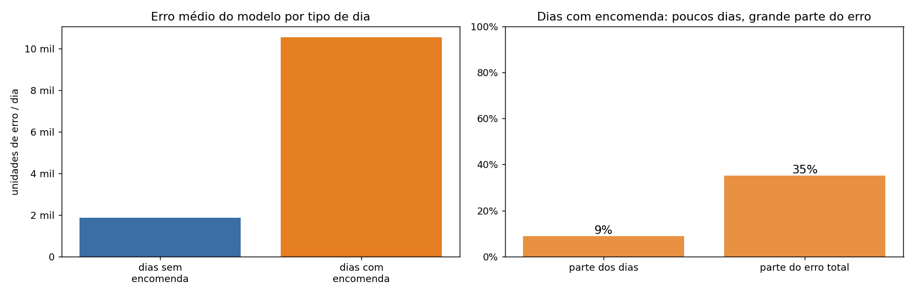
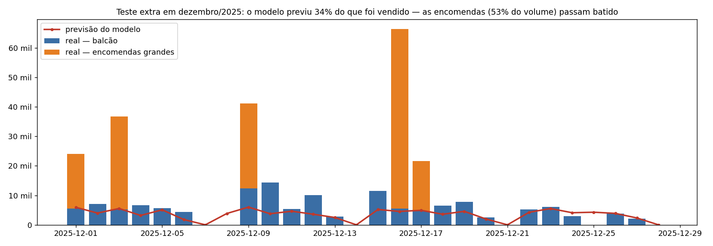
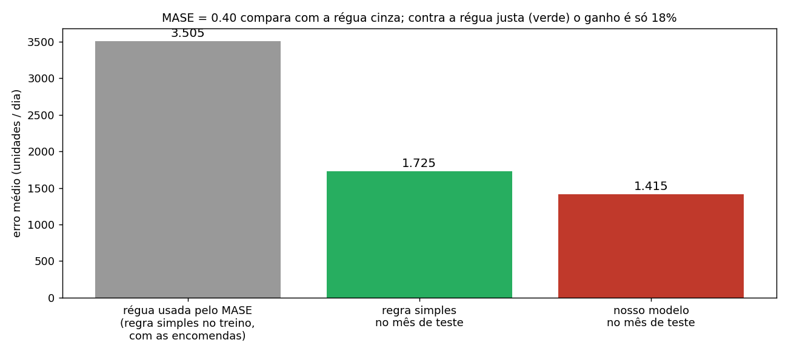
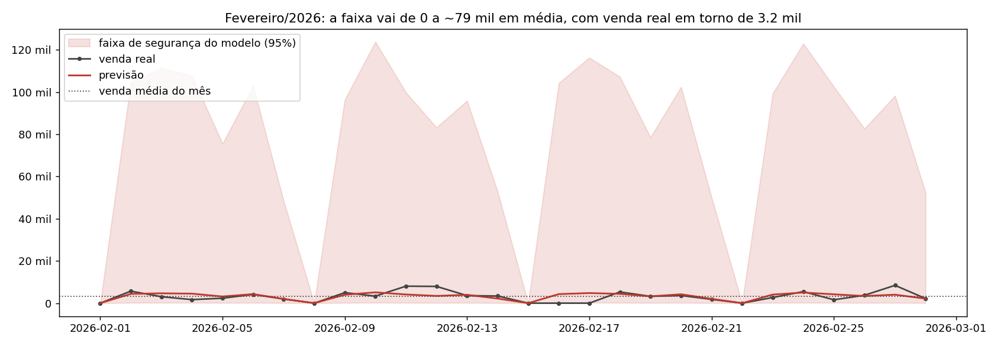
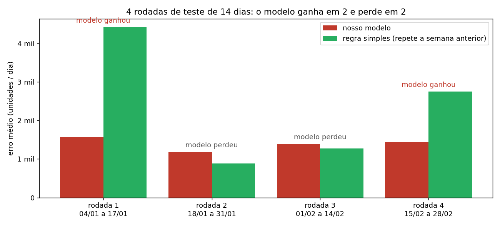
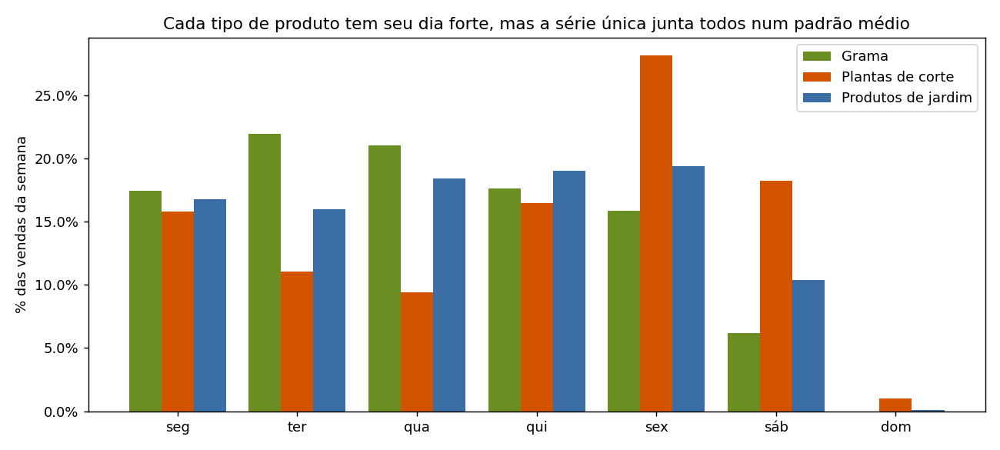

# 02 — Primeiro treino: previsão com os dados crus (antes do EDA)

**Experimento:** `A0_sarima_serie_crua_pre_eda` · **Data:** 2026-09-27 ·
**Branch:** `train/sarimax-serie-crua-pre-eda`

> **Resumo em uma frase:** com os dados como estavam antes do estudo (EDA), o modelo
> aprendeu o ritmo da semana, mas é só um pouco melhor que "repetir a semana passada".
> Não enxerga as encomendas grandes, os feriados (como o Carnaval) nem as mudanças de
> temporada, e dá uma faixa de segurança larga demais para ser usada. Pelas regras formais
> do projeto ele "passaria", mas por um erro de régua. Este é o **ponto zero** contra o
> qual vamos medir as melhorias.

---

## 1. Por que fizemos este treino

Queremos mostrar, no TCC, **quanto cada etapa do trabalho melhora a previsão**. Para isso
precisamos de um "antes" honesto:

| Etapa | O que muda | Status |
| --- | --- | --- |
| **0. Este treino** | dados crus, sem nenhum ajuste descoberto no estudo | ✅ feito |
| 1. Achados do EDA | separar encomendas, cortar picos, uma previsão por loja | próximo |
| 2. Calendário | ensinar feriados e datas comemorativas (Natal, Dia das Mães…) | depois |
| 3. Dados externos | clima, feriados municipais | depois |

---

## 2. Como o treino foi feito (passo a passo)

**Dados usados.** A base de vendas do jeito que estava em 30/08/2026, depois da limpeza de
colunas e da classificação dos produtos em categorias, **antes** de qualquer análise. Na
época ainda eram 3 "lojas" (Jardim Canadá, Itabirito e Garden Center).

**Uma única linha do tempo.** Somamos tudo o que foi vendido em cada dia, em todas as
lojas e todos os tipos de produto. O resultado é uma lista de 789 dias (02/01/2024 a
28/02/2026), cada um com um número: o total de unidades vendidas naquele dia.

- Tiramos só os lançamentos de **serviços e taxas** (frete, prestação de serviço), que não
  são produto. Essa regra já existia antes do estudo.
- **Não tiramos nada mais**: encomendas grandes, devoluções e dias fora do comum ficaram
  como estavam.
- Dias sem venda (quase todos domingos, loja fechada) entraram como zero.

**O modelo.** Usamos um modelo estatístico clássico de séries temporais (SARIMA). Ele olha
**só para o próprio histórico de vendas** e aprende duas coisas: o quanto um dia se parece
com os dias anteriores e o ciclo de 7 dias da semana. Ele **não recebeu nenhuma
informação extra**: não sabe o que é feriado, Natal ou chuva. O programa testou 36
configurações do modelo e ficou com a que melhor se ajustou aos dados.

**Como testamos (separação entre treino e teste).** O modelo é sempre avaliado em dias
que ele **não viu** ao aprender:

- **Teste principal:** aprendeu com tudo até 31/01/2026 e previu fevereiro inteiro (28
  dias). Depois comparamos com o que foi vendido de verdade.
- **Teste repetido (4 rodadas):** simula o uso real. Em cada rodada o modelo aprende com o
  que aconteceu até uma data e prevê as 2 semanas seguintes.

  | Rodada | Aprende com dados até | Prevê |
  | --- | --- | --- |
  | 1 | 03/01/2026 | 04/01 a 17/01 |
  | 2 | 17/01/2026 | 18/01 a 31/01 |
  | 3 | 31/01/2026 | 01/02 a 14/02 |
  | 4 | 14/02/2026 | 15/02 a 28/02 |

- **Teste extra em dezembro** (feito para este diagnóstico): aprendeu até 30/11/2025 e
  previu 01/12 a 28/12, o mês mais difícil do ano.

**Com o que comparamos.** Com uma **regra simples**: "amanhã vai vender o mesmo que no
mesmo dia da semana passada". Se o modelo não ganha dessa regra com folga, ele não se
paga.

---

## 3. Resultados

| O que medimos | Fevereiro (teste principal) | 4 rodadas (média) | Dezembro (teste extra) |
| --- | --- | --- | --- |
| Erro médio por dia (unidades) | 1.415 | 1.394 | 7.677 |
| Erro da regra simples no mesmo período | 1.725 | 2.333 | 7.691 |
| **Quanto o modelo foi melhor que a regra simples** | **18%** | **17%¹** (ganhou em 2 de 4) | **0%** (empate) |
| Venda média por dia no período | 3.152 | 3.168 | 10.525 |
| Largura média da faixa de segurança (95%) | 79 mil | 81 mil | — |

¹ Média do ganho de cada rodada. Comparando os erros médios da tabela (1.394 × 2.333), o
ganho parece ser de 40%. Mas quase todo ele vem das rodadas 1 e 4, em que a regra simples
copiou uma semana com pico e errou muito (ver §4.6). Nas semanas normais, o modelo perdeu.





**O que deu certo:**

- O modelo aprendeu o **ritmo da semana**: prevê zero no domingo e acompanha a subida e a
  descida dos dias úteis.
- Em fevereiro, o **total do mês** previsto ficou só 4% acima do real.
- Os erros não seguem um padrão que o modelo tenha deixado de aproveitar. Ou seja, com
  **só o histórico**, não dá para tirar muito mais do que isso.

---

## 4. Por que o resultado não foi bom

### 4.1 Os picos são, em boa parte, encomendas grandes que o modelo não tem como prever

A linha do tempo mistura duas coisas bem diferentes: a **venda do dia a dia** (muitas
compras pequenas, com ritmo previsível) e as **encomendas grandes** de obra e paisagismo.
São poucas vendas enormes, como 20 mil m² de grama numa única nota, que dependem de um
cliente fechar negócio, não do dia da semana.



- Só **99 vendas** (0,03% de todas) são encomendas grandes pela regra do projeto, mas
  somam **13% de tudo o que foi vendido**.
- Nos **10 dias de maior venda**, mais da metade (54%) do volume veio dessas encomendas.
- Sem as encomendas, a linha do tempo fica bem mais calma: a variação cai de 1,10 para 0,87.
- Nem todo pico é encomenda. Alguns dias são altos por somarem muitas vendas médias (painel
  de baixo). Por exemplo, em 31/01/2024 foram 40 mil unidades de produtos de jardim em 104
  notas, e a maior delas tinha só 12% do dia (EDA §3.7). Para esses dias, o estudo propôs um
  **teto**, que também não foi aplicado aqui.

### 4.2 O erro se concentra nos dias de encomenda



Nos dias de encomenda, o modelo erra em média **10,5 mil unidades**, contra **1,9 mil**
nos outros dias. Esses dias são só **9%** do calendário, mas respondem por **35% de todo o
erro**.

### 4.3 Em dezembro, o modelo previu só um terço do que foi vendido



O teste principal caiu num mês calmo (fevereiro), o que ajudou o modelo. Quando testamos em
dezembro:

- ele previu **99 mil** unidades, e foram vendidas **295 mil** (34%);
- **53%** do que foi vendido em dezembro veio de encomendas grandes, e nenhuma foi prevista;
- mesmo **sem as encomendas**, o modelo previu cerca de 28% a menos que o balcão vendeu.
  **Não é efeito de Natal**: o EDA (§3.4) mostra que grama e produtos de jardim até vendem
  menos em volta do Natal. O que houve foram duas coisas. Primeiro, o fim de 2025 foi uma
  temporada alta (balcão de 5,8 a 7,0 mil por dia de setembro a dezembro, contra 3,5 mil em
  janeiro), e o modelo puxa a previsão para o nível médio do histórico. Segundo, 27% do
  balcão de dezembro veio de 35 vendas médias (500 unidades ou mais), grandes, mas abaixo do
  limite que define encomenda;
- a regra simples de "repetir a semana passada" se saiu **igual** ao modelo.

É o mês em que a floricultura mais precisa de uma boa previsão, e é onde o modelo falha.

### 4.4 A nota oficial parece ótima, mas por causa de uma régua frouxa



A nota oficial do projeto (MASE) compara o erro do modelo com o erro da regra simples
**no período de treino**. Como o treino tem as encomendas gigantes, a regra simples errava
muito ali (3.505 por dia), e qualquer erro parece pequeno perto disso: a nota deu 0,40,
que parece excelente. Comparando com a regra simples **no mesmo mês de teste**, o ganho é
de só 18%.

**Conclusão:** a nota oficial não serve para comparar este treino com os próximos. Vamos
usar a comparação "modelo × regra simples no mesmo período".

### 4.5 A faixa de segurança é larga demais para ser útil



Além da previsão, o modelo dá uma faixa de "mínimo e máximo prováveis". Em fevereiro essa
faixa foi de **0 a cerca de 80 mil unidades por dia**, enquanto a venda real ficou perto de
3 mil. A faixa quase nunca erra, mas não ajuda ninguém a decidir quanto comprar.

> **Correção (2026-09-27, após o [doc 03](03-enriquecimento_serie_crua.md)):** a primeira
> versão deste documento atribuía a faixa larga às encomendas. A causa principal eram os
> **feriados**. O modelo trabalha numa escala que "estica" a diferença entre zero e o resto,
> e nela um feriado com a loja fechada (venda zero), que o modelo não sabia prever, destoa
> muito mais do que uma encomenda. Medido: 79% da variação que alarga a faixa vinha dos
> feriados e só 5% dos dias com encomenda. Com o calendário, a faixa cai de ~79 mil para
> ~13 mil.

### 4.6 Ganhar da regra simples só metade das vezes não é confiável



O modelo só ganhou com folga quando a regra simples copiou uma semana atípica:

- **Rodada 1** (04 a 17/01): a regra copiou a semana do Ano-Novo, com o feriado de 01/01
  zerado e um dia de 25 mil unidades em 02/01.
- **Rodada 4** (15 a 28/02): a regra copiou 11 e 12/02, dias de cerca de 8 mil unidades.

Nas rodadas 2 e 3, semanas normais, a regra simples foi **melhor** que o modelo.

**O Carnaval pegou os dois.** Em 16 e 17/02/2026 (segunda e terça de Carnaval) a venda foi
zero. O modelo previu cerca de 4,3 e 4,8 mil, porque não sabe que é Carnaval. Só esses 2
dias respondem por **23% de todo o erro de fevereiro**. Sem eles, o erro médio do mês cai de
1.415 para 1.175 por dia. Isso é justamente o que o calendário resolve (§5, item 3).

### 4.7 Tudo misturado numa linha só



Cada tipo de produto tem seu dia forte: grama vende mais na terça e quarta, e plantas de
corte na sexta e sábado. Somando tudo, o modelo só enxerga um ritmo médio. Aqui o efeito
é pequeno, porque grama e produtos de jardim são 98% do volume e têm ritmos parecidos. Ele
volta a importar quando a previsão for dividida entre produtos. Pelo mesmo motivo, a troca
do Garden Center para outro CNPJ em 2025 **não atrapalhou** este treino: no total da
empresa, as vendas só mudam de "etiqueta".

---

## 5. O que precisa ser resolvido para um treino melhor

Em ordem de impacto esperado:

1. **Separar as encomendas grandes da venda do dia a dia.** É o problema nº 1: gera os
   picos e boa parte do erro, principalmente em dezembro. As encomendas viram um fluxo à
   parte, que não se repõe por estoque (regra já definida no ADR-012).
2. **Pôr um teto nos dias fora do comum** que sobram no balcão, só na hora de ensinar o
   modelo. Na hora de medir o erro, os valores reais continuam intactos.
3. **Ensinar o calendário ao modelo.** Feriados, véspera de feriado e datas comemorativas
   (Dia das Mães, Namorados, Finados, Natal). Resolve dias como o Carnaval, com 23% do erro
   de fevereiro, e o Ano-Novo (§4.6), e é o que mais estreita a faixa de segurança (§4.5).
   **Feito no [doc 03](03-enriquecimento_serie_crua.md).** O **Carnaval precisa entrar
   explicitamente**, porque é ponto facultativo, não feriado nacional por lei. A BrasilAPI,
   usada no doc 03, já o inclui. Atenção: o efeito das datas comemorativas muda de sentido conforme o tipo de
   produto (EDA §3.4), e o calendário **não** resolve a falha de dezembro de 2025, que foi
   temporada alta e vendas médias, não Natal (§4.3).
4. **Acompanhar mudanças de nível.** O modelo demora a perceber quando a loja entra numa
   fase de venda mais alta ou mais baixa, como no fim de 2025. Vale testar dar mais peso às
   semanas recentes, ou incluir tendência (EDA §4, item 5).
5. **Uma previsão por loja** (Jardim Canadá, com o Garden Center incluído, e Itabirito). As
   lojas têm tamanhos e comportamentos diferentes, e é por loja que a reposição é feita.
6. **Corrigir um detalhe do teste.** A escolha da melhor configuração do modelo foi feita
   uma vez só, com os dados até 31/01. Por isso, nas rodadas 1 e 2, essa escolha já tinha
   "visto" os dias que depois foram testados. O modelo em si não viu as respostas, e o
   efeito deve ser pequeno, mas o certo é refazer a escolha dentro de cada rodada.
7. **Medir de um jeito justo e igual para todos os treinos:**
   - modelo × regra simples **no mesmo período** (e em quantas rodadas o modelo ganha);
   - **largura da faixa de segurança**, e não só quantas vezes ela acerta;
   - incluir **dezembro** entre os testes, porque um modelo que só funciona em mês calmo não
     serve;
   - como os próximos treinos preveem por loja, **somar as previsões das lojas** e comparar
     com este total, nas mesmas datas.

### O que disso já estava previsto no EDA

| Problema | Previsto no EDA? | Onde |
| --- | --- | --- |
| Encomendas grandes misturadas à venda do dia a dia | **Sim**, com a regra de separação já decidida | EDA §3.7 e §3.12; ADR-012 |
| Picos restantes do balcão | **Sim** (teto no 99º percentil, só no treino) | EDA §3.2 e §4, itens 2 e 12 |
| Uma previsão por loja, Garden Center junto de Jardim Canadá | **Sim** | EDA §3.0, §3.11 e §4, item 10 |
| Calendário e datas comemorativas | **Sim**, com o efeito calculado por categoria | EDA §3.3, §3.4 e §4, itens 3 e 4 |
| Encomendas continuam imprevisíveis mesmo depois | **Sim** (o "limite honesto": para prevê-las seria preciso a carteira de pedidos) | EDA §3.12; §5, pergunta 9 |
| Mudança de nível no fim de 2025 | **Em parte** (o EDA sugere ajuste de tendência, mas não fala da temporada alta de set–dez/2025) | EDA §3.5 e §4, item 5 |
| Vendas médias (500 ou mais) abaixo do limite de encomenda | **Em parte** (o teto do balcão atenua; ninguém mediu o peso delas em dezembro) | este documento, §4.3 |
| MASE inflado pela escala do treino | **Não** (o EDA mede com MASE, WAPE e erro acumulado; só um aviso indireto no "limite honesto") | este documento, §4.4 |
| Faixa de segurança (IC 95%) larga demais | **Não** (o EDA não avaliou a faixa) | este documento, §4.5 |
| Escolha da configuração dentro de cada rodada | **Não se aplica ao EDA**: lá a configuração foi fixada de antemão, sem escolha | este documento, §5, item 6 |
| Carnaval (loja fechada; 23% do erro de fevereiro) | **Só no código**: `eda/_common.py` já trata Carnaval como feriado móvel, mas nenhum documento o cita e o plano de dados externos só fala em feriados nacionais | este documento, §4.6 |
| Testar também em dezembro | **Sim** (o EDA usa 26 rodadas cobrindo um ano inteiro) | `eda_grupos.py`, `N_FOLDS = 26` |

---

## 6. Arquivos

| O quê | Onde |
| --- | --- |
| Script do treino | `ia-predictor/training_scripts/baseline/sarimax_serie_crua.py` |
| Script deste diagnóstico | `ia-predictor/training_scripts/baseline/analise_serie_crua.py` |
| Resultados do treino | `training_scripts/results/metrics/baseline_A0_sarima_serie_crua_pre_eda.json` |
| Previsão × real, dia a dia (fevereiro) | `…/baseline_A0_sarima_serie_crua_pre_eda_holdout.csv` |
| Números do diagnóstico | `…/baseline_A0_sarima_serie_crua_pre_eda_diagnostico.json` |
| Gráficos 01–11 | `training_scripts/results/plots/baseline/` |

Para refazer (a partir de `ia-predictor/`):

```bash
python -m training_scripts.baseline.sarimax_serie_crua     # treino (~2,5 min)
python -m training_scripts.baseline.analise_serie_crua     # diagnóstico e gráficos 05–11
```

### Ficha técnica (para o texto do TCC)

- **Base:** `data/processed/contas_a_receber_taxonomia.csv`, Etapa 3 de 2026-08-30 (commit
  `8e5aa6e`); 333.019 linhas, 5.342 de `Servico e taxa` excluídas.
- **Série:** Σ `qtdade` diária, todas as unidades e categorias; 789 dias, 135 zerados; média
  4.995, mediana 3.931, máx. 66.377, CV 1,10.
- **Modelo:** SARIMA(1,0,1)(1,0,1)₇ com constante, sem exógenas; log1p (CV > 0,7); d = 0
  (ADF p < 0,001); grid p,q ∈ {0,1,2}, P,Q ∈ {0,1}, D = 0, seleção por AIC (2.898,2).
- **Hold-out (28 d):** MAE 1.415 · RMSE 2.117 · MASE 0,404 · RMSSE 0,319 · MAE/MAE_naïve
  0,82 · cobertura IC95 92,9% · largura IC95 79,2 mil · Ljung-Box p (7/14) 0,79/0,91 ·
  Shapiro p ≈ 0.
- **Walk-forward (4 × 14 d):** MASE 0,396 · RMSSE 0,289 · MAE/MAE_naïve 0,83 (vence em 2/4)
  · cobertura IC95 96,4% · largura IC95 81,4 mil.
- **Carnaval (16–17/02/2026, real = 0):** 22,9% do erro absoluto do hold-out; MAE sem esses
  dias 1.175 (naïve 1.501).
- **Dezembro/2025 (28 d, diagnóstico):** MAE 7.677 · MASE 2,34 · MAE/MAE_naïve 1,00 ·
  previsto/real 34%.
- **Encomendas (ADR-012, k = 5, só para diagnóstico):** 99 linhas · 13,1% do volume · 69
  dias · 35% do erro absoluto do treino em 8,8% dos dias.
- **Status pelos limiares do CLAUDE.md:** `trained`. Não é conclusivo, porque o MASE está
  inflado pela escala do treino (§4.4).
