# 03 — Segundo treino: a mesma série crua, agora com calendário e clima

**Experimento:** `enriquecimento_serie_crua_pre_eda` · **Data:** 2026-09-27 ·
**Branch:** `train/sarimax-serie-crua-enriquecida` · Continuação de
[02-baseline_serie_crua_pre_eda.md](02-baseline_serie_crua_pre_eda.md)

> **Resumo:** ensinar o **calendário** ao modelo valeu a pena. Ele passou a acertar os
> feriados (loja fechada), a faixa de segurança ficou **6 vezes mais estreita** e, num teste
> de um ano inteiro, o erro caiu 9% e o modelo passou a ganhar da regra simples em 22 de 26
> rodadas (antes eram 19). O **clima não ajudou**, mesmo no cenário mais favorável.
> Continuam de pé três problemas: as **encomendas grandes** (dezembro segue com só 35%
> previsto; no ano, 48% do erro cai em 11% dos dias), a **dificuldade em acompanhar fases de
> alta e de baixa**, e um **defeito na forma de informar as datas comemorativas**, que sozinho
> gerou 12% do erro do ano.

---

## 1. Por que fizemos este treino

O primeiro treino (doc 02) mediu o **ponto zero**: a série crua, sem ajuda nenhuma. Aqui
medimos **só o efeito do enriquecimento**: a mesma série e o mesmo modelo, mas agora com
informações de fora.

| Etapa | O que muda | Status |
| --- | --- | --- |
| 0. Série crua (doc 02) | nada | ✅ feito |
| **1. Série crua + calendário e clima (este doc)** | informações externas | ✅ feito |
| 2. Achados do EDA | separar encomendas, cortar picos, uma previsão por loja | próximo |
| 3. EDA + calendário | as duas melhorias juntas | depois |

---

## 2. Como o treino foi feito (passo a passo)

**Mesma estratégia do primeiro treino.** A mesma linha do tempo (todas as lojas somadas,
dados de 30/08/2026, antes do estudo, sem separar encomendas), o mesmo modelo, a mesma forma
de escolher a configuração e os mesmos testes. **A única diferença é a informação extra**
que o modelo recebe. Assim, qualquer melhora vem só dela.

**Três versões, lado a lado:**

| Versão | O que o modelo recebe além do histórico de vendas |
| --- | --- |
| **A0** · sem nada extra | nada: é o primeiro treino, refeito aqui para conferência (deu os mesmos números) |
| **A1** · + calendário | dia da semana; **feriado / loja fechada**; véspera e dia seguinte a feriado; os 7 dias até cada data comemorativa (Dia das Mães, Namorados, Dia da Mulher, Pais, Finados, Natal); primeira semana do mês (dia de pagamento) |
| **B** · + calendário + clima | tudo do A1 + chuva do dia, chuva acumulada na semana e temperatura máxima |

**De onde vieram os dados novos:**

- **Feriados nacionais:** [BrasilAPI](https://brasilapi.com.br), gratuita. Já inclui
  Carnaval, Sexta-feira Santa, Corpus Christi e Consciência Negra (20/11, feriado nacional
  desde 2024). Isso responde à dúvida do plano de experimentos: a fonte traz o Carnaval.
- **Fechamentos locais:** não existe fonte pronta de feriados municipais. Olhamos nos
  próprios dados os dias úteis em que **as duas lojas** ficaram sem venda sem ser feriado
  nacional. Apareceram **15/08** (nos dois anos) e **08/12/2025**. Entraram como "loja
  fechada" e viraram pergunta para a floricultura (EDA §5, pergunta 10).
- **Clima:** [Open-Meteo](https://open-meteo.com), gratuito, dados diários de chuva e
  temperatura para Jardim Canadá (Nova Lima) e Itabirito.
- **Ficaram de fora, de propósito:** indicadores econômicos (inflação, juros). São mensais,
  mudam devagar e não explicam a venda de um dia para o outro num horizonte de 2 semanas.
  Buscas no Google também ficaram de fora, porque a fonte é instável.

Tudo o que foi baixado fica guardado em `ia-predictor/data/external/`, para o experimento
poder ser refeito sem internet.

**Uma descoberta antes de treinar.** Em **todos os feriados** de segunda a sábado, as duas
lojas venderam **zero**. A única exceção foi Itabirito no Finados de 2024 (718 unidades). O
modelo sem calendário não sabe disso e prevê cerca de 4 mil unidades nesses dias.

**Como testamos.** Os mesmos testes do primeiro treino, mais dois novos:

| Teste | Período | Observação |
| --- | --- | --- |
| Fevereiro (principal) | 01 a 28/02/2026 | igual ao primeiro treino |
| 4 rodadas | 04/01 a 28/02/2026 | igual ao primeiro treino |
| **Dezembro** | 01 a 28/12/2025 | o mês mais difícil |
| **Ano inteiro** | 26 rodadas de 2 semanas, mar/2025 a fev/2026 | **o teste mais confiável**: passa por todas as estações, feriados e datas |

No ano inteiro e em dezembro, a melhor configuração do modelo foi escolhida **só com dados
até 01/03/2025**, antes de qualquer período testado. Isso corrige o detalhe apontado no
primeiro treino (doc 02, §5 item 6).

**Com o que comparamos.** Com a mesma **regra simples** do primeiro treino: "amanhã vai
vender o mesmo que no mesmo dia da semana passada".

---

## 3. Resultados

### 3.1 Erro comparado com a regra simples

O erro do modelo dividido pelo erro da regra simples, **no mesmo período**. Abaixo de 100%,
o modelo é melhor.

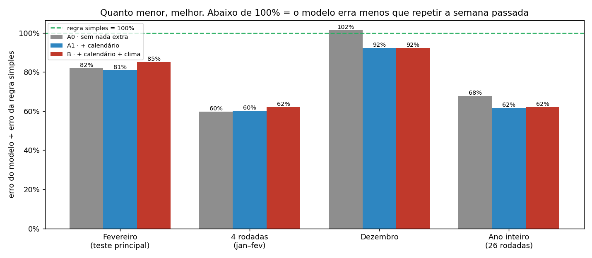

| Teste | A0 · sem nada | A1 · + calendário | B · + calendário + clima |
| --- | --- | --- | --- |
| Fevereiro | 82% | 81% | 85% |
| 4 rodadas (jan–fev) | 60% · ganhou 2 de 4 | 60% · ganhou 2 de 4 | 62% · ganhou 2 de 4 |
| Dezembro | 102% (perdeu) | **92%** | 92% |
| **Ano inteiro** | 68% · ganhou **19** de 26 | **62%** · ganhou **22** de 26 | 62% · ganhou 22 de 26 |
| Erro médio no ano (unidades/dia) | 3.024 | **2.749** (−9%) | 2.775 |

> **Nota sobre as "4 rodadas":** no doc 02 esse resultado aparece como 83%, que é a média do
> ganho de cada rodada. Aqui usamos o erro total do período dividido pelo erro total da regra
> simples (60%). É a mesma conta usada para o ano inteiro, e é menos sensível a uma rodada
> isolada. Os dois números descrevem o mesmo modelo.

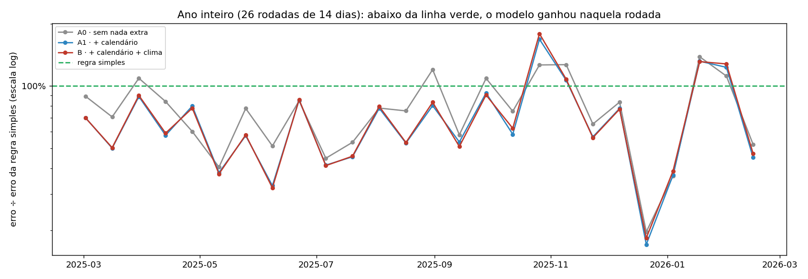

### 3.2 O que deu certo

**Feriados resolvidos.** No ano de teste caíram 14 feriados de segunda a sábado. Sem
calendário, o modelo errava em média **3.988 unidades** em cada um. Com calendário, o erro
caiu para **praticamente zero**. O Carnaval de fevereiro/2026, que respondia por 23% do erro
do primeiro treino, agora é previsto certo.

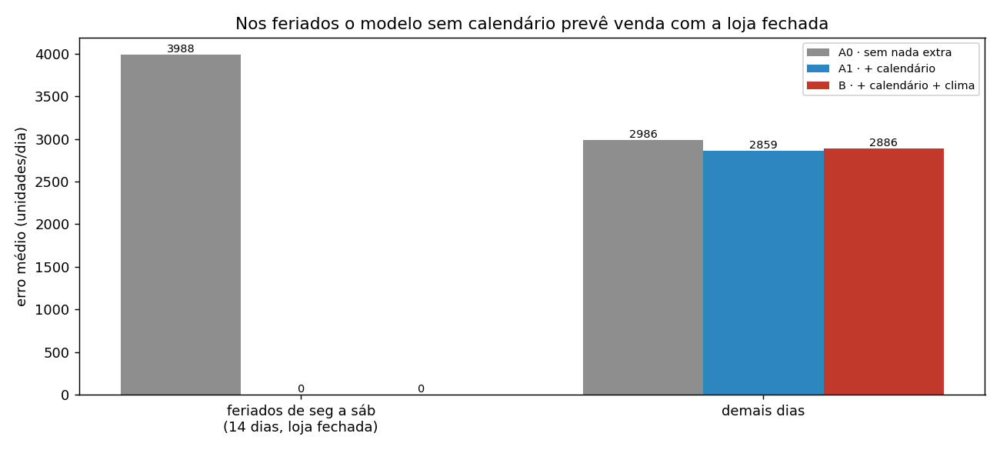

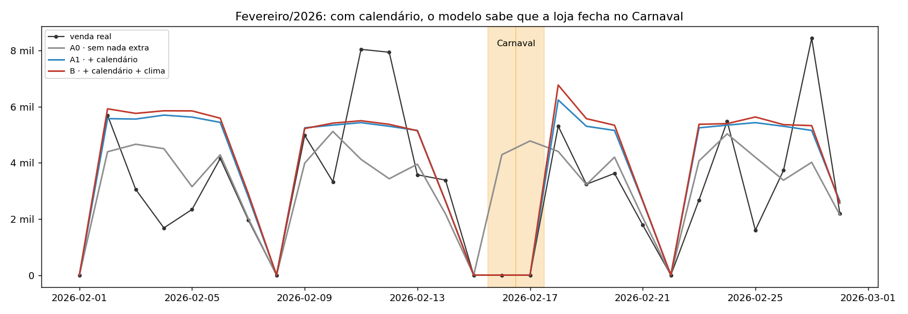

**Faixa de segurança 6 vezes mais estreita.** A faixa de "mínimo e máximo prováveis" caiu de
**~79 mil** para **~13 mil** unidades por dia. No ano inteiro, ela acerta 94% das vezes,
dentro do esperado para uma faixa de 95%.

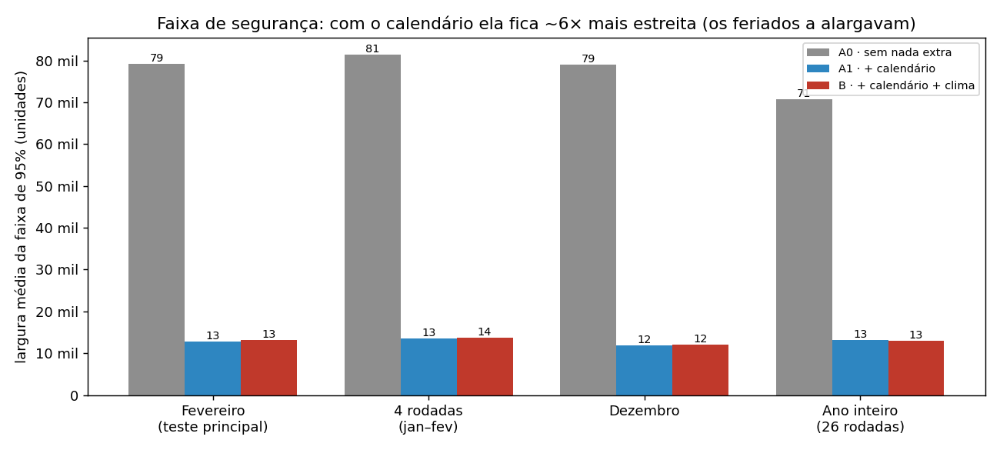

**E descobrimos por que ela era larga.** No doc 02 atribuímos a faixa larga às encomendas.
Estava errado: a causa principal eram os **feriados**. O modelo trabalha numa escala que
"estica" a diferença entre zero e o resto, e nela um feriado com loja fechada, que o modelo
não sabia prever, destoa muito mais do que uma encomenda. Sem calendário, **79%** da
"surpresa" do modelo vinha dos feriados e só **5%** dos dias com encomenda. O doc 02 foi
corrigido.

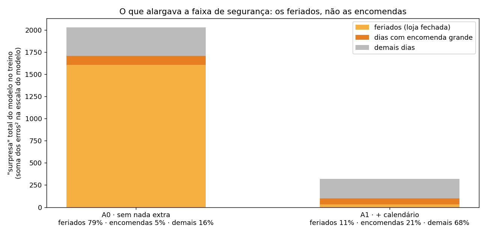

### 3.3 O clima não ajudou

O modelo B (com clima) empatou ou ficou um pouco **pior** que o A1 em todos os testes. E isso
usando o clima que **de fato aconteceu**, como se a previsão do tempo fosse perfeita. Com a
previsão do tempo real, que erra, o resultado só poderia ser igual ou pior.

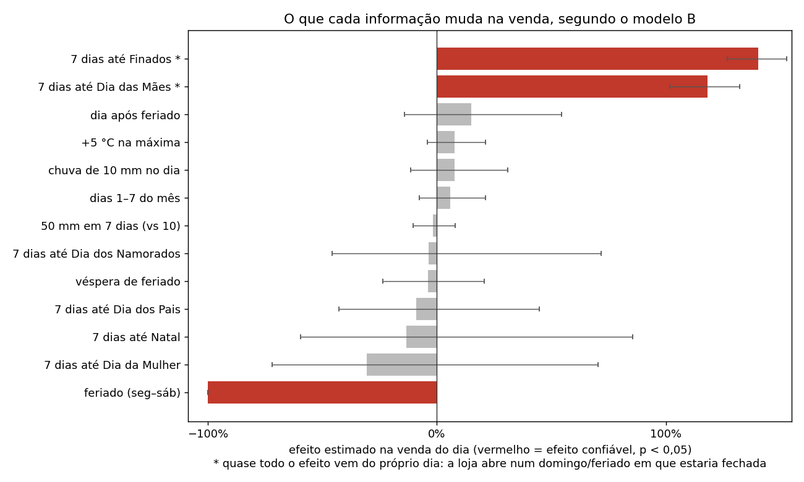

| Variável | Efeito estimado na venda do dia | Confiável? |
| --- | --- | --- |
| Chuva de 10 mm no dia | +3% (entre −5% e +12%) | não |
| Semana chuvosa (50 mm contra 10 mm) | −1% (entre −7% e +5%) | não |
| +5 °C na temperatura máxima | +8% (entre −4% e +21%) | não |

Na análise por floresta aleatória (a ponderação prevista no projeto), o clima somou **1,4%**
da importância, contra 83% do dia da semana e 15% do feriado:

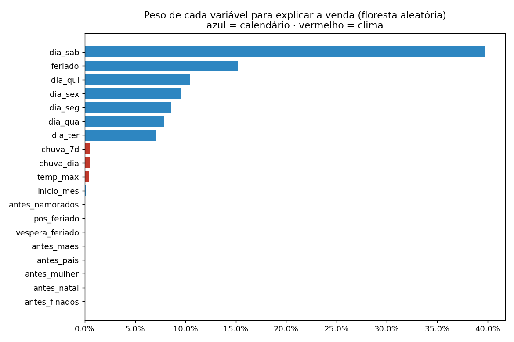

**Por que o clima não pesa aqui:** grama e produtos de jardim (98% do volume) são comprados
para obras e jardins planejados com antecedência, e a chuva de um dia muda pouco essa
compra. O clima pode fazer diferença em flores de corte, mas elas são só 2% do volume e
somem numa série que soma tudo.

### 3.4 As outras variáveis de calendário

- Véspera de feriado, dia seguinte a feriado e primeira semana do mês: **nenhum efeito
  confiável**.
- Namorados, Dia da Mulher, Pais e Natal: **nenhum efeito confiável** na venda total. Faz
  sentido com o EDA (§3.4): essas datas empurram flores para cima e grama para baixo, e no
  total os efeitos se anulam.
- Dia das Mães e Finados aparecem com efeito **enorme** (+159% e +280%), mas é um engano da
  forma como a informação foi passada ao modelo. Ver §4.3.

---

## 4. Por que ainda não é bom

### 4.1 As encomendas grandes continuam sendo o maior erro

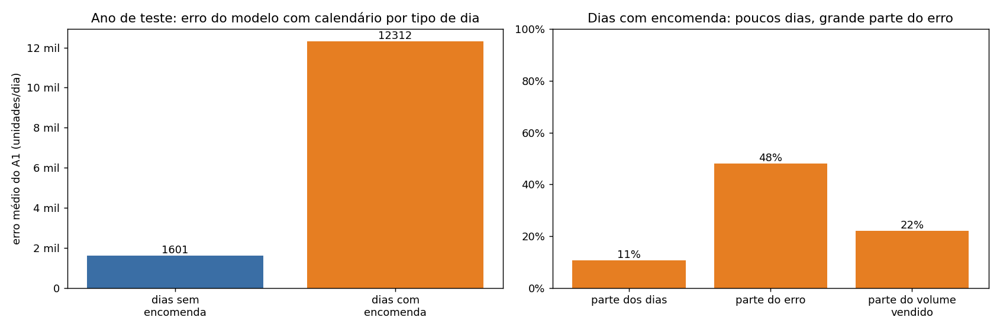

No ano de teste, os dias com encomenda grande são só **11%** dos dias, mas concentram
**48% do erro** do modelo com calendário. Nesses dias ele erra em média **12,3 mil
unidades**; nos outros, **1,6 mil**. As encomendas foram **22%** de tudo o que se vendeu no
ano.

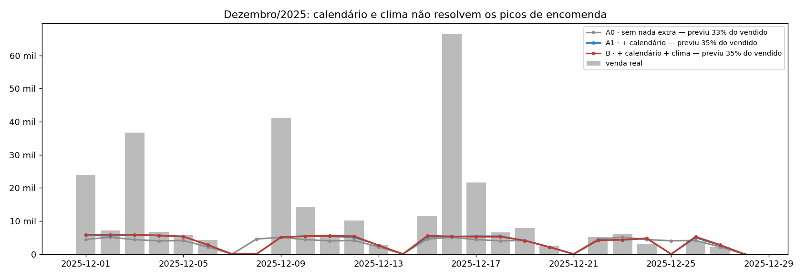

Em dezembro, o modelo previu só **35%** do que foi vendido. Nenhum calendário prevê em que
dia um cliente vai fechar um pedido de 20 mil m² de grama. Olhando **só o balcão**, sem as
encomendas, a previsão cobriu **74%** do vendido: melhor, mas ainda abaixo, porque o fim de
2025 foi uma temporada alta (ver §4.2).

### 4.2 O modelo não acompanha as fases de alta e de baixa

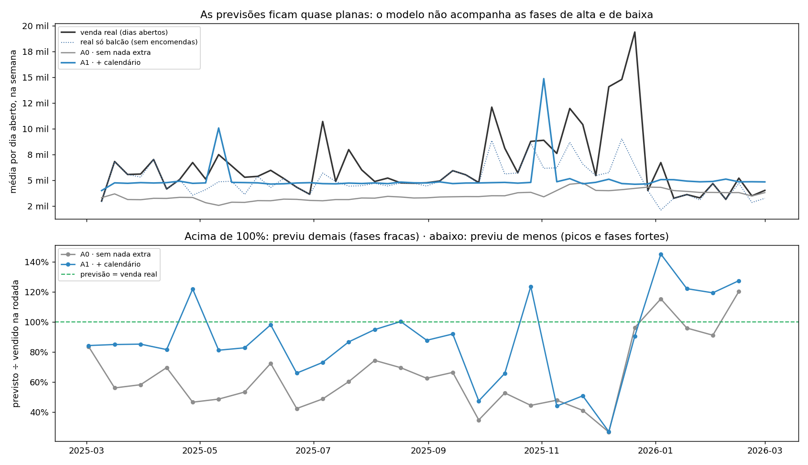

As previsões ficam **quase planas** ao longo do ano, em torno do nível médio do histórico,
enquanto a venda real sobe e desce por fases:

- **Fases fortes** (out–dez/2025): o modelo prevê **de menos**. Em 15 das 26 rodadas ele
  previu menos de 90% do que foi vendido. Parte disso são as encomendas, mas o balcão
  também subiu (linha pontilhada) e o modelo não subiu junto.
- **Fases fracas** (jan–fev/2026): prevê **demais**. Em fevereiro, o A1 previu **23% a mais**
  do que foi vendido (108 mil contra 88 mil).

Com o calendário explicando domingos e feriados, a configuração escolhida passou a ter pouca
"memória" das semanas recentes, e a previsão volta rápido para a média. O A0 também é plano,
mas num nível mais baixo, e por isso errou menos em fevereiro e mais no resto do ano.

### 4.3 A forma de informar Dia das Mães e Finados gerou 12% do erro do ano

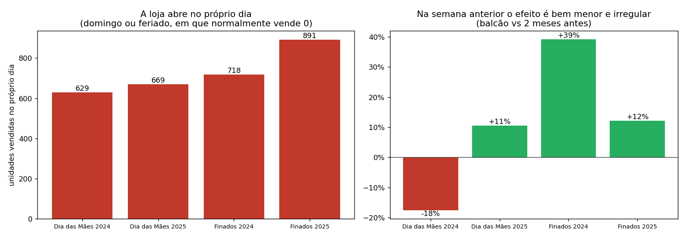

A variável dizia ao modelo "estamos nos 7 dias antes da data". O que os dados mostram é
diferente:

- **No próprio dia, a loja abre excepcionalmente.** Os únicos domingos com venda em todo o
  histórico são os dois Dias das Mães (629 e 669 unidades) e o Finados de 2025 (891). O
  Finados de 2024 caiu num sábado feriado e também teve venda (718). Sair de 0 para ~700
  pesa muito na escala do modelo.
- **A semana anterior vende só um pouco diferente**: de −18% a +39% no balcão, comparada
  aos 2 meses anteriores.

O modelo atribuiu o salto do dia à semana inteira. Resultado no ano de teste: na semana do
Dia das Mães de 2025 ele previu ~12,7 mil por dia útil, e na de Finados ~18,7 mil, quando o
normal é ~5 mil. No próprio dia, quando a loja abriu, previu zero. **Só essas duas semanas
respondem por 12% de todo o erro do ano.** Corrigir a variável é simples e deve melhorar o
A1 ainda mais.

### 4.4 A faixa de segurança ainda é larga

Mesmo 6 vezes mais estreita, a faixa ainda equivale a ~2,5 vezes a venda média do dia no
ano, e ~4 vezes em fevereiro, que foi um mês fraco. Sem os feriados, o que sobra de
"surpresa" vem dos dias comuns (68%) e das encomendas (21%).

---

## 5. O que precisa ser resolvido para um treino melhor

Em ordem de impacto esperado:

1. **Separar as encomendas grandes da venda do dia a dia** (ADR-012). Agora é, com folga, o
   problema nº 1: 48% do erro do ano e o motivo de dezembro sair em 35%.
2. **Trocar "7 dias até a data" por "loja aberta excepcionalmente no dia"** no Dia das Mães
   e em Finados. É uma correção simples que remove 12% do erro do ano. Perguntar à
   floricultura se há outras datas assim (EDA §5, pergunta 10).
3. **Acompanhar o nível recente.** Testar configurações com mais memória (por exemplo, forçar
   um termo que olha as semanas anteriores) ou dar mais peso ao passado recente. A
   separação das encomendas deve ajudar aqui também, porque hoje elas bagunçam o "nível".
4. **Manter só o calendário que funciona:** dia da semana e feriado/loja fechada. Véspera,
   pós-feriado, início do mês e as outras datas não mostraram efeito e podem sair, ou voltar
   a ser testadas quando a previsão for por categoria.
5. **Deixar o clima de fora** da versão principal. Reavaliar só para flores de corte, se um
   dia essa categoria for prevista à parte.
6. **Uma previsão por loja** (Jardim Canadá com Garden Center, e Itabirito), como decidido no
   EDA. Comparar com este experimento somando as previsões das lojas nas mesmas datas.
7. **Manter a régua de avaliação deste experimento:** ano inteiro com 26 rodadas,
   configuração escolhida só com dados anteriores, erro relativo à regra simples, largura da
   faixa e dezembro à parte.

### O que disso já estava previsto no EDA

| Problema | Previsto no EDA? | Onde |
| --- | --- | --- |
| Feriados e loja fechada (incluindo Carnaval) | **Sim**, no código (`eda/_common.py` tem feriados fixos e móveis) e no item 13 da §4 | EDA §3.4 e §4, itens 3, 4 e 13 |
| Encomendas continuam sendo o maior erro | **Sim** | EDA §3.12; ADR-012; §4, item 12 |
| Datas comemorativas com efeito oposto por categoria (se anulam no total) | **Sim** | EDA §3.4 |
| Faixa larga causada pelos feriados, não pelas encomendas | **Não** (o EDA não avaliou a faixa; o doc 02 atribuiu às encomendas e estava errado) | este documento, §3.2; EDA §4, item 15 (corrigido) |
| Abertura excepcional em Dia das Mães e Finados | **Não** (o EDA mediu o efeito "em torno" das datas por categoria, sem separar o dia da semana anterior) | este documento, §4.3; EDA §4, item 18 |
| Fechamentos locais em 15/08 e 08/12 | **Não** | este documento, §2; EDA §5, pergunta 10 |
| Clima sem ganho na série total | **Não testado no EDA** (o plano previa testar) | este documento, §3.3; EDA §4, item 19 |
| Previsões planas, sem acompanhar fases | **Em parte** (EDA §4, item 5, sugere tendência; o doc 02 registrou a mudança de nível) | este documento, §4.2; EDA §4, item 16 |

---

## 6. Arquivos

| O quê | Onde |
| --- | --- |
| Script do experimento | `ia-predictor/training_scripts/enriched/sarimax_serie_crua_enriquecida.py` |
| Script deste diagnóstico | `ia-predictor/training_scripts/enriched/analise_enriquecimento.py` |
| Busca de feriados e clima | `ia-predictor/training_scripts/preprocessing/dados_externos.py` (movido de `enriched/` em 2026-09-27) |
| Dados externos (cache) | `ia-predictor/data/external/` |
| Resultados | `training_scripts/results/metrics/enriquecimento_serie_crua_pre_eda.json` |
| Números do diagnóstico | `…/enriquecimento_serie_crua_pre_eda_diagnostico.json` |
| Previsões dia a dia (todos os testes e modelos) | `…/enriquecimento_serie_crua_pre_eda_previsoes.csv` |
| Variáveis usadas, dia a dia | `…/enriquecimento_serie_crua_pre_eda_exogenas.csv` |
| Gráficos 01–12 | `training_scripts/results/plots/enriquecido/` |

Para refazer (a partir de `ia-predictor/`):

```bash
python -m training_scripts.enriched.sarimax_serie_crua_enriquecida                # treino (~30 min)
python -m training_scripts.enriched.sarimax_serie_crua_enriquecida --so-graficos  # só os gráficos 01–08
python -m training_scripts.enriched.analise_enriquecimento                        # diagnóstico e gráficos 09–12
```

### Ficha técnica (para o texto do TCC)

- **Série:** a mesma do A0-crua (doc 02). Mesmo grid (p,q ∈ {0,1,2}; P,Q ∈ {0,1}; D = 0;
  m = 7), AIC, log1p, d por ADF.
- **Ordens escolhidas:** A0 SARIMA(1,0,1)(1,0,1)₇ no hold-out e (1,0,2)(1,0,1)₇ no ano. A1 e
  B SARIMAX(0,0,2)(0,0,1)₇ nos dois. AIC do hold-out: A0 2.898,2 · A1 1.528,4 · B 1.531,4.
- **Exógenas A1 (16):** 6 dummies de dia da semana (ref. domingo), feriado (BrasilAPI +
  fechamentos locais 15/08/2024, 15/08/2025, 08/12/2025; só seg–sáb), véspera, pós-feriado,
  6 janelas de 7 dias até datas comemorativas, dias 1–7 do mês. **B (19):** + log1p(chuva
  do dia), log1p(chuva 7 d), temperatura máxima (média de 2 pontos Open-Meteo/ERA5).
- **Hold-out 28 d (A0 / A1 / B):** MAE 1.415 / 1.397 / 1.467 · MASE 0,404 / 0,399 / 0,419 ·
  MAE/naïve 0,82 / 0,81 / 0,85 · cobertura IC95 92,9 / 100 / 100% · largura 79,2 / 12,8 /
  13,1 mil · previsto/real 104 / 123 / 126%.
- **Ano (26 × 14 d, ordem escolhida com dados até 01/03/2025):** MAE 3.024 / 2.749 / 2.775
  · ΣAE/ΣAE_naïve 0,677 / 0,616 / 0,622 · vence naïve 19 / 22 / 22 · cobertura 95,6 /
  93,7 / 93,7% · largura 70,8 / 13,1 / 13,0 mil · MAE em feriados (14 dias) 3.988 / 0,5 /
  0,5.
- **Dezembro/2025:** MAE 7.807 / 7.102 / 7.101 · MAE/naïve 1,02 / 0,92 / 0,92 ·
  previsto/real 33 / 35 / 35%. A1 previsto/balcão 74%.
- **Coeficientes (B, hold-out), efeito = e^β − 1:** feriado −100% (p < 0,001); janela Mães
  +159% (p < 0,001) e Finados +280% (p < 0,001), ambos dominados pela abertura excepcional
  no próprio dia; chuva do dia +3% (p = 0,46); chuva 7 d −1% (p = 0,74); temp. máx. +1,5%/°C
  (p = 0,21); demais datas, véspera, pós-feriado e início do mês com p > 0,3.
- **Diagnóstico (A1, ano):** dias com encomenda (ADR-012, k = 5) = 10,7% dos dias, 48,0% do
  erro absoluto, 22,0% do volume; MAE 12.312 nesses dias e 1.601 nos demais. Rodadas com
  previsto/real < 90%: 15/26; > 110%: 6/26. Semanas de Mães/2025 e Finados/2025: 12,2% do
  erro absoluto do ano.
- **Faixa de 95%, soma dos resíduos² (escala log, treino do hold-out):** A0 = feriados 79% ·
  dias com encomenda 5% · demais 16% (σ² = 2,59). A1 = 11% · 21% · 68% (σ² = 0,42).
- **Importância RF/MDI (B):** dia da semana 83,2% · feriado 15,2% · clima 1,4% · demais
  < 0,5%. Pesar as exógenas pela importância, como previsto no CLAUDE.md, não muda o ajuste
  de um SARIMAX linear: o coeficiente absorve a escala. Por isso o MDI foi usado aqui só
  como diagnóstico.
- **Resíduos:** Ljung-Box p (7/14) A1 0,69/0,48, B 0,70/0,45 (sem autocorrelação); Shapiro
  p ≈ 0 em todos.
