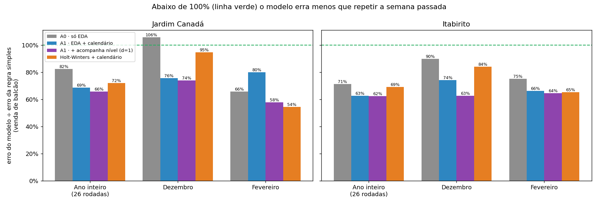
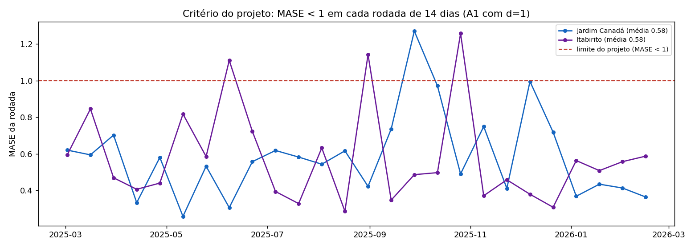
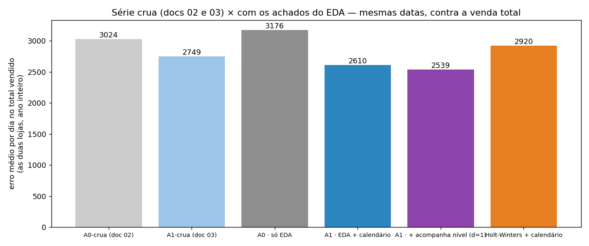
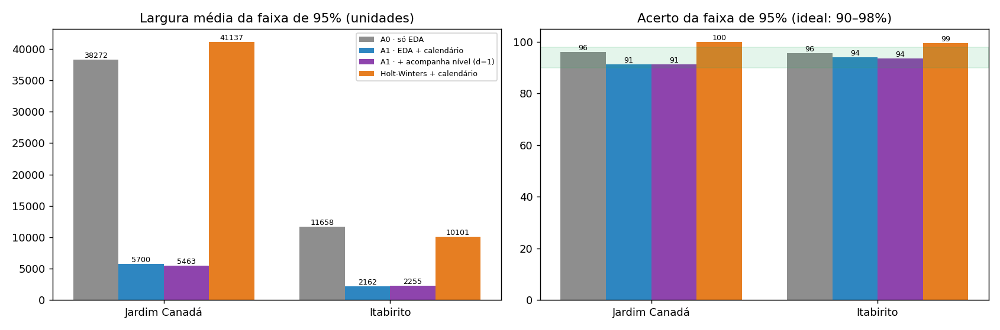
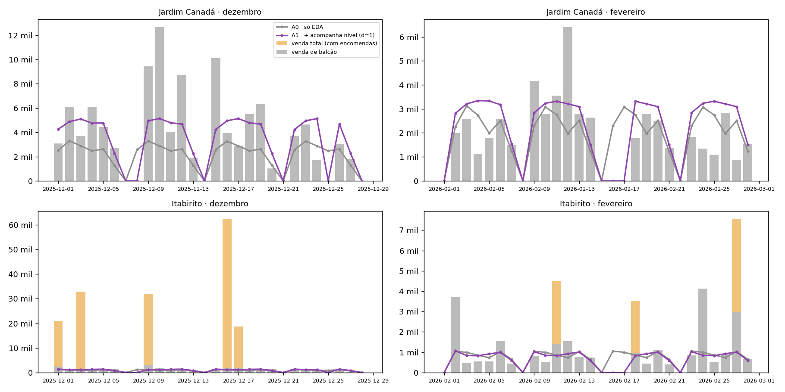
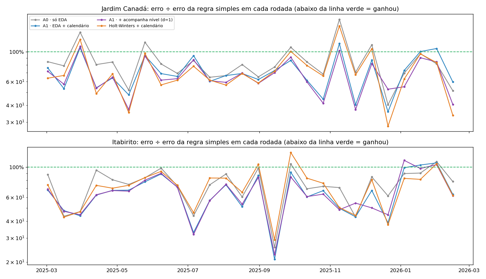
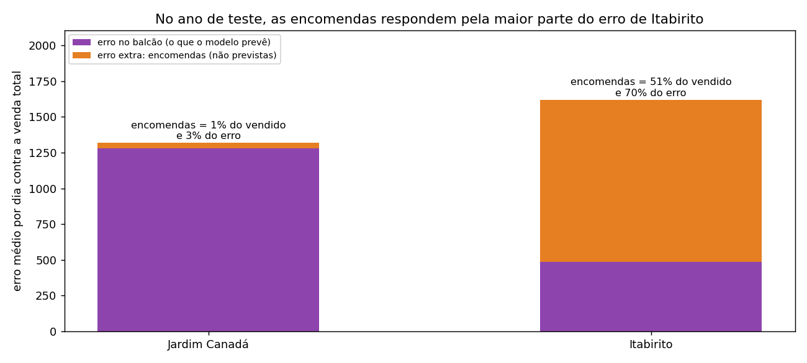
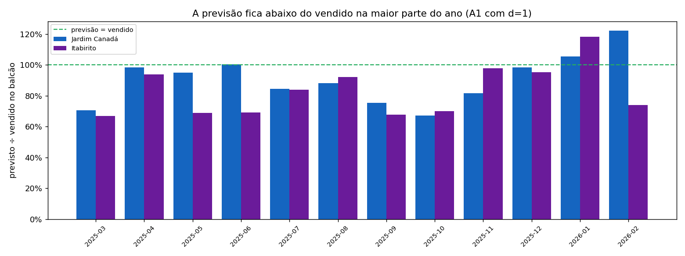
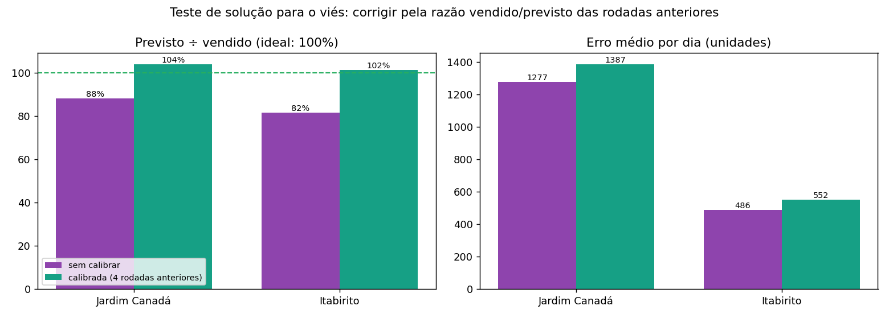
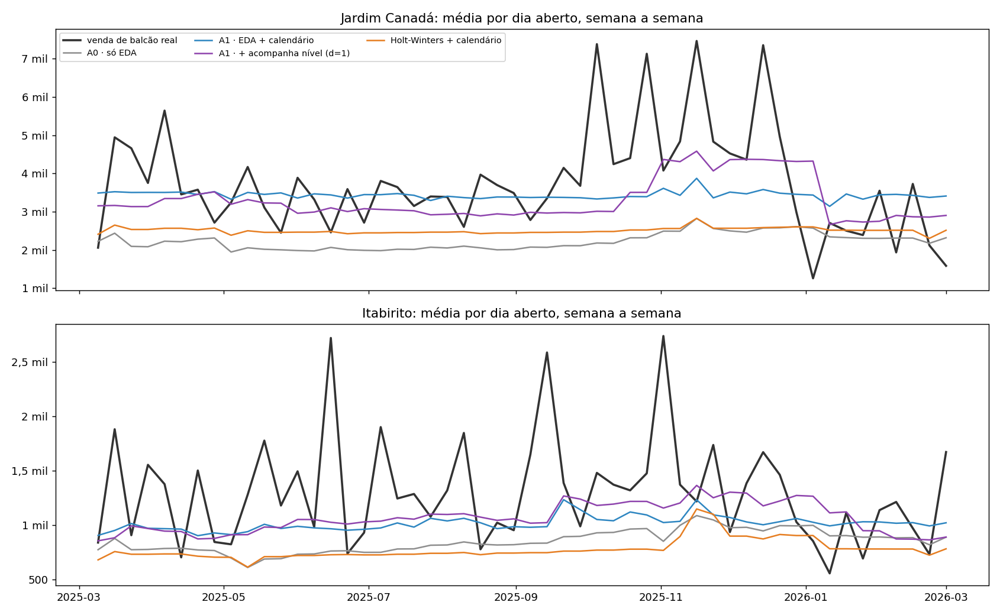

# 04 — Terceiro treino: previsão por loja com os achados do EDA

**Experimento:** `l1_por_loja_eda` · **Data:** 2026-09-27 · **Branch:** `train/sarimax-l1-por-loja`
· Continuação de [02](02-baseline_serie_crua_pre_eda.md) e [03](03-enriquecimento_serie_crua.md)
· Bases do [pré-processamento v2](01-pre_processing.md) (§6–§11)

> **Resumo:** com os achados do EDA aplicados (uma previsão por loja, encomendas fora, teto
> nos picos) e o calendário corrigido, o modelo **cumpre o critério do projeto nas duas
> lojas**: erra de 34% a 38% menos que "repetir a semana passada", ganha em 24 de 26
> rodadas, tem MASE 0,58 e uma faixa de segurança útil (~5,5 mil em Jardim Canadá e ~2,3
> mil em Itabirito, acertando 91–94%). A melhor versão é a que **acompanha o nível recente**
> (d = 1), que resolveu fevereiro. Continuam em aberto dois problemas, agora bem medidos:
> as **encomendas** (51% do que Itabirito vendeu no ano de teste e 70% do erro dessa loja)
> e um **viés para baixo** (a previsão cobre 81–88% do vendido). A §5 propõe a solução de
> cada um.

---

## 1. Por que fizemos este treino

| Etapa | O que muda | Status |
| --- | --- | --- |
| 0. Série crua (doc 02) | nada | ✅ |
| 1. Série crua + calendário e clima (doc 03) | informações externas | ✅ calendário ajuda, clima não |
| **2. Achados do EDA + calendário corrigido (este doc)** | por loja, encomendas fora, teto, calendário por loja | ✅ |
| 3. Desagregação por categoria e produto | dividir a previsão da loja | próximo (§5) |

---

## 2. Como o treino foi feito

**Dados.** As bases prontas do pré-processamento v2 (`training_scripts/output/`): a série
diária por loja, o calendário por loja e as linhas de venda com a marcação de encomenda.

**O que o modelo prevê.** A **venda de balcão de cada loja**, por dia: tudo menos as
encomendas grandes (ADR-012). Uma previsão para Jardim Canadá e outra para Itabirito.

**Cuidados para o teste ser honesto:**

- **A marcação de encomenda é refeita em cada rodada**, só com as vendas anteriores à data
  da rodada. O teste nunca usa o futuro para decidir o que é encomenda.
- **Teto nos picos** (99º percentil dos dias abertos) aplicado **só nos dados de treino** de
  cada rodada. O erro é sempre medido contra a venda real.
- **A configuração de cada modelo é escolhida só com dados anteriores à 1ª rodada**
  (até 01/03/2025).

**As quatro versões:**

| Versão | O que tem |
| --- | --- |
| **A0** · só EDA | por loja, encomendas fora, teto; sem calendário |
| **A1** · EDA + calendário | + dia da semana, `loja_fechada` e `abertura_excepcional` (sem a janela de 7 dias que atrapalhou no doc 03) |
| **A1 d=1** · + acompanha o nível | igual ao A1, mas o modelo prevê a **variação** em relação aos dias recentes. Assim a previsão parte do nível atual em vez de voltar para a média do histórico (doc 03 §4.2) |
| **Holt-Winters** | outro tipo de modelo, com nível que se adapta sozinho; calendário aplicado depois (previsão 0 com a loja fechada) |

**Os testes** são os mesmos do doc 03, nas mesmas datas: um ano inteiro com **26 rodadas de
2 semanas** (mar/2025 a fev/2026), dezembro/2025 e fevereiro/2026. Comparamos com a regra
simples "repetir a mesma semana passada" e com os treinos na série crua.

**Um erro corrigido no meio do caminho.** A primeira rodada deste treino usou uma correção
para "voltar" da escala do modelo para unidades (o fator de Duan, usado no EDA). Em Itabirito
sem calendário essa correção multiplicou todas as previsões por **4,6**: poucos erros enormes,
no dia seguinte a cada feriado, dominavam a média. Ela foi descartada. A previsão passou a ser a
**mediana**, que é a melhor escolha para a medida de erro usada aqui e a mesma dos docs 02 e
03. O efeito colateral dessa escolha (um viés para baixo) está na §4.2.

---

## 3. Resultados

### 3.1 Por loja

Erro do modelo ÷ erro da regra simples, na venda de balcão, no mesmo período. Abaixo de
100%, o modelo é melhor.



**Jardim Canadá**

| Versão | Ano inteiro | Rodadas vencidas | Dezembro | Fevereiro | MASE | Faixa de 95% (largura · acerto) |
| --- | --- | --- | --- | --- | --- | --- |
| A0 · só EDA | 83% | 21 de 26 | 106% | 66% | 0,73 | 38 mil · 96% |
| A1 · + calendário | 69% | 22 de 26 | 76% | 80% | 0,61 | 5,7 mil · 91% |
| **A1 d=1** | **66%** | **24 de 26** | **74%** | 58% | **0,58** | **5,5 mil · 91%** |
| Holt-Winters | 72% | 22 de 26 | 95% | **54%** | 0,64 | 41 mil · 100% |

**Itabirito**

| Versão | Ano inteiro | Rodadas vencidas | Dezembro | Fevereiro | MASE | Faixa de 95% (largura · acerto) |
| --- | --- | --- | --- | --- | --- | --- |
| A0 · só EDA | 71% | 24 de 26 | 90% | 75% | 0,66 | 11,7 mil · 96% |
| A1 · + calendário | 63% | 24 de 26 | 74% | 66% | 0,58 | 2,2 mil · 94% |
| **A1 d=1** | **62%** | **24 de 26** | **63%** | **64%** | **0,58** | **2,3 mil · 94%** |
| Holt-Winters | 69% | 23 de 26 | 84% | 65% | 0,65 | 10,1 mil · 100% |

**A melhor versão nas duas lojas é a A1 d=1.** O Holt-Winters ganhou em fevereiro em Jardim
Canadá, mas perde no ano, em dezembro e na faixa de segurança (larga demais para uso).

Em unidades, o erro médio da A1 d=1 no ano é de **1.282 por dia em Jardim Canadá** (contra
1.948 da regra simples) e de **486 por dia em Itabirito** (contra 780).

### 3.2 Critério do projeto: cumprido

O CLAUDE.md exige MASE < 1 e faixa de 95% acertando entre 90% e 98% para o modelo ser
aprovado (`trained`).



| Loja | MASE médio (A1 d=1) | Rodadas com MASE < 1 | Acerto da faixa de 95% | Status |
| --- | --- | --- | --- | --- |
| Jardim Canadá | 0,58 | 25 de 26 | 91,2% | **trained** |
| Itabirito | 0,58 | 23 de 26 | 93,7% | **trained** |

O MASE é mais otimista que o erro relativo à regra simples no mesmo período (0,58 contra
0,62–0,66), pelo mesmo motivo explicado no doc 02 §4.4: a régua do MASE vem do treino, que é
mais agitado. Os dois critérios apontam na mesma direção.

### 3.3 Comparação com os treinos na série crua

Para comparar com os docs 02 e 03, que previam o **total** das lojas somadas, somamos as
previsões das duas lojas e medimos contra a **venda total**, encomendas incluídas, nas mesmas
datas.



| Treino | Erro médio por dia no total (ano inteiro) |
| --- | --- |
| A0-crua (doc 02) | 3.024 |
| A1-crua, com calendário (doc 03) | 2.749 |
| A0 · só EDA (este doc) | 3.176 |
| A1 · EDA + calendário | 2.610 |
| **A1 d=1** | **2.539** (−16% contra o doc 02, −8% contra o doc 03) |
| Holt-Winters | 2.920 |

O ganho no total é menor que o ganho por loja porque **as encomendas agora ficam fora da
previsão de propósito**, mas continuam na venda total contra a qual este quadro mede. É o
problema da §4.1.

### 3.4 Calendário: feriados e abertura excepcional

- **Feriados:** com calendário, o erro nos dias de loja fechada fica em **~0** nas duas lojas
  (sem calendário, 2.512 por feriado em Jardim Canadá e 959 em Itabirito).
- **Abertura excepcional de Itabirito** (Dia das Mães e Finados): o erro nesses dias caiu de
  **780** (sem calendário) para **131** (A1) e **50** (A1 d=1). A correção do doc 03 §4.3
  funcionou: a semana anterior não é mais inflada.

### 3.5 Faixa de segurança



Com o calendário, a faixa ficou útil: ~5,5 mil em Jardim Canadá (venda média de balcão ~3,3
mil por dia) e ~2,3 mil em Itabirito (~1,1 mil por dia). No doc 02 ela era de ~80 mil.

### 3.6 Dezembro, fevereiro e o ano rodada a rodada





Em dezembro, o balcão de Itabirito é bem previsto (erro 63% do da regra simples). As barras
laranja, que são as encomendas, continuam fora do alcance de qualquer modelo.

---

## 4. Por que ainda não resolve tudo

### 4.1 Encomendas: a maior parte do erro de Itabirito



No ano de teste (mar/2025–fev/2026), **as encomendas foram 51% de tudo o que Itabirito
vendeu**. No histórico inteiro eram 36%: elas cresceram muito em 2025. Medido contra a venda
total, **70% do erro dessa loja vem delas**. Em Jardim Canadá, elas são 1,5% do volume e 3% do
erro.

O modelo faz bem o que se propõe (prever o balcão), mas **metade da venda de Itabirito não
passa por ele**. Isso não se resolve com outro modelo: a encomenda depende de um cliente
fechar negócio, e o histórico não diz quando isso acontece.

### 4.2 A previsão fica abaixo do vendido



No ano, a previsão cobre **87,5% do balcão de Jardim Canadá** e **80,9% do de Itabirito**. O
desvio muda ao longo do ano: fica abaixo de março a novembro, fase de venda mais forte, e
acima em jan–fev/2026, fase fraca.

**Por quê.** A previsão é a **mediana**: o valor com metade de chance de vender mais e
metade de vender menos. Numa venda com dias fortes esporádicos, a mediana fica abaixo da
**média**. Para errar pouco no dia a dia, a mediana é a certa. Para somar a semana e decidir
a compra, ela subestima.

**Testamos uma correção simples** (gráfico 09): multiplicar cada rodada pela razão
"vendido ÷ previsto" das 4 rodadas anteriores. O viés some (104% e 102%), mas o **erro do dia
a dia piora 9% em Jardim Canadá e 14% em Itabirito**. Não existe um número único que seja
ótimo para as duas coisas, e por isso a solução proposta (§5, passo 2) entrega dois números.



### 4.3 As previsões ainda são suaves



A versão d=1 acompanha melhor as fases do que as outras: sobe no fim de 2025 em Jardim
Canadá e desce em janeiro. Mas ainda com atraso e sem acompanhar os picos semanais. Parte
disso é inevitável, porque são picos que nenhuma informação antecipa. Parte pode melhorar
com o reajuste semanal do modelo (§5, passo 3).

---

## 5. Próximos passos, pensando na solução

Em ordem de impacto para a floricultura. Cada passo diz o problema, a solução proposta, como
validar e do que depende.

### Passo 1 — Encomendas como fluxo próprio (Itabirito)

- **Problema:** 51% da venda de Itabirito no último ano, 70% do erro dessa loja (§4.1).
- **Solução:**
  1. **Carteira de pedidos.** Pedir à floricultura o registro das encomendas **antes** da
     venda (orçamento, pedido, agenda de entrega; EDA §5, pergunta 9). Com ele, a previsão do
     dia passa a ser **balcão previsto + encomendas já combinadas**. O modelo não precisa
     adivinhar o que já está agendado.
  2. **Enquanto não houver carteira:** o painel mostra a previsão do balcão e, **à parte**,
     um indicador de encomendas por loja e mês (frequência, volume típico, maiores clientes),
     como alerta e não como previsão. Assim a gestora vê, por exemplo, quantas encomendas
     grandes Itabirito costuma ter em cada época do ano, sem que isso distorça a previsão
     do balcão.
  3. **Não misturar as duas coisas num número só.** Somar à previsão uma "média de
     encomendas" pioraria o erro de todos os dias sem encomenda, que são 90% dos dias em Itabirito.
- **Como validar:** com a carteira, refazer o teste do ano medindo contra a **venda total**.
  O erro de Itabirito deve cair na proporção das encomendas combinadas com antecedência.
- **Depende de:** resposta da floricultura.

### Passo 2 — Dois números: "venda mais provável" e "quanto ter disponível"

- **Problema:** a previsão (mediana) cobre 81–88% do vendido (§4.2). Calibrar para 100% piora
  o erro do dia a dia em 9–14%.
- **Solução:** entregar **dois valores por dia**, os dois saídos do mesmo modelo:
  - **venda mais provável** (mediana): usada no gráfico e nas métricas de erro;
  - **quantidade para ter disponível**: um ponto mais alto da faixa de previsão (por
    exemplo, o valor que só é ultrapassado em 30% dos dias). O modelo já calcula essa faixa
    inteira, então o cálculo é direto.

  Qual ponto usar é decisão do negócio: quanto a floricultura aceita sobrar para não faltar.
  Isso casa com o ADR-011, em que o sistema **informa** e a loja **decide** a compra.
- **Como validar:** para cada ponto oferecido (60%, 70%, 80%), conferir no ano de teste se a
  venda real ficou abaixo dele na proporção prometida (por exemplo, 70% dos dias abaixo do
  ponto de 70%). Medida recomendada: *pinball loss*, o erro próprio para esse tipo de
  previsão.
- **Depende de:** nada; pode ser feito já, com as previsões salvas.

### Passo 3 — Acompanhar melhor o nível

- **Problema:** previsões suaves e com atraso nas fases de alta e de baixa (§4.3).
- **Soluções a testar, no mesmo protocolo deste doc:**
  1. **Reajuste semanal**, como o sistema fará em produção (scheduler de segunda-feira): no
     teste, reajustar a cada 7 dias em vez de 14.
  2. **Janela de treino recente** (por exemplo, os últimos 12 meses), para que 2024 pese
     menos quando o nível mudou.
  3. **Combinação A1 d=1 + Holt-Winters** (média das duas previsões): o Holt-Winters foi o
     melhor em fevereiro em Jardim Canadá, e combinar modelos diferentes costuma reduzir o
     erro.
- **Como validar:** erro relativo no ano, em dezembro e em fevereiro, e o viés mês a mês
  (gráfico 07) mais perto de 100%.
- **Depende de:** nada.

### Passo 4 — Desagregação: da loja para a categoria e o produto (L2)

- **Problema:** a floricultura compra por produto, não por loja.
- **Solução:** repartir a previsão da loja em cascata (loja → categoria → produto) pela
  participação recente de cada nível × o perfil de dia da semana do nível, como decidido no
  ADR-011. Usar a base `serie_diaria_unidade_categoria.csv` e, para as datas comemorativas,
  as colunas `dias_ate_*` do calendário (EDA §3.4: flores sobem e grama cai nas datas).
- **Como validar:** MASE e erro relativo **por categoria** e para os 20 produtos principais,
  contra a regra simples no mesmo nível, nas mesmas 26 rodadas.
- **Depende de:** passos 2 e 3 (a desagregação herda o viés e o nível da loja).

### Passo 5 — Comparação acadêmica: hierárquico × por produto

- **Solução:** Croston, TSB e SBA direto na série de cada produto, contra o L1 + desagregação,
  nas mesmas rodadas (plano de experimentos, Fase 4A).
- **Depende de:** passo 4.

### Passo 6 — Organização do código de teste

- **Problema:** os três treinos (docs 02, 03 e 04) repetem o protocolo de avaliação com
  pequenas diferenças.
- **Solução:** criar `training_scripts/validation/` com o protocolo único (26 rodadas,
  marcação de encomenda por rodada, métricas justas, MASE formal, faixa), usado por todos os
  experimentos daqui em diante.

### Passo 7 — Levar para o sistema (Fase 5)

- Levar as Etapas 4–7 para `backend/domain/etl` e `features`, o L1 A1 d=1 para
  `backend/domain/models` e os dois números do passo 2 para a API de previsão e o painel.
- Reajuste semanal (segunda, 02:00) e geração diária (03:00), como no CLAUDE.md.

### Perguntas que continuam com a floricultura

- **Carteira de encomendas** (passo 1; EDA §5, pergunta 9).
- **Fechamentos de 15/08 e 08/12**: são feriados municipais? Se forem, passam a ser
  projetados para os próximos anos (EDA §5, pergunta 10).
- **Devoluções**: como tratar (EDA §5, pergunta 4).
- **Quanto a loja aceita sobrar para não faltar** (define o ponto do passo 2).

---

## 6. O que já estava previsto no EDA

| Achado deste treino | Previsto? | Onde |
| --- | --- | --- |
| Separar encomendas e prever o balcão melhora muito Itabirito | **Sim** | EDA §3.12, ADR-012 |
| Calendário por loja e abertura excepcional | **Sim**, desde o doc 03 | EDA §4 itens 13 e 18 |
| Acompanhar o nível melhora fevereiro e dezembro | **Em parte** (EDA §4 item 5 sugeria tendência) | EDA §4 item 16 |
| Encomendas passaram de 36% para 51% do volume de Itabirito no último ano | **Em parte** (EDA §3.12 já mostrava 68 mil em 2024 → 377 mil em 2025) | este documento, §4.1 |
| Viés da mediana (previsão abaixo do vendido) | **Não** | este documento, §4.2 |
| Fator de Duan instável | **Não** (o EDA usou esse fator; aqui ele explodiu) | este documento, §2 |

---

## 7. Arquivos

| O quê | Onde |
| --- | --- |
| Script do treino | `ia-predictor/training_scripts/baseline/sarimax_l1_por_loja.py` |
| Script do diagnóstico | `ia-predictor/training_scripts/baseline/analise_l1_por_loja.py` |
| Resultados | `training_scripts/results/metrics/l1_por_loja_eda.json` |
| Previsões dia a dia (todas as lojas, versões e testes) | `…/l1_por_loja_eda_previsoes.csv` |
| Números do diagnóstico (MASE, viés, encomendas, calibração) | `…/l1_por_loja_eda_diagnostico.json` |
| Gráficos 01–10 | `training_scripts/results/plots/l1_por_loja/` |

Para refazer (a partir de `ia-predictor/`, depois de `python -m training_scripts.preprocessing.run_all`):

```bash
python -m training_scripts.baseline.sarimax_l1_por_loja                 # treino (~25 min)
python -m training_scripts.baseline.sarimax_l1_por_loja --so-graficos   # só os gráficos 01–06
python -m training_scripts.baseline.analise_l1_por_loja                 # diagnóstico e gráficos 07–10
```

### Ficha técnica (para o texto do TCC)

- **Alvo:** `qtd_balcao` diário por unidade; encomenda = linha > 5 × mediana diária (seg–sáb)
  da unidade × categoria, **limiar recalculado por origem** com `marcar(..., data_corte=origem)`.
  Teto: winsorização no p99 dos dias abertos, só no treino. `log1p`.
- **Exógenas (A1):** 6 dummies de dia da semana (ref. domingo), `loja_fechada`,
  `abertura_excepcional` (calendário da Etapa 6).
- **Seleção de ordem:** grid p,q ∈ {0,1,2}; P,Q ∈ {0,1}; D = 0; m = 7; AIC; d por ADF (A0, A1)
  ou fixo em 1 (A1 d=1); **uma seleção por loja e versão, com dados até 01/03/2025**.
  Ordens: JC A0 (1,0,2)(1,0,1)₇ · A1 (0,0,2)(0,0,1)₇ · A1 d=1 (0,1,1)(0,0,1)₇; ITA A0
  (0,0,2)(1,0,1)₇ · A1 (1,0,2)(0,0,1)₇ · A1 d=1 (0,1,1)(0,0,1)₇. Holt-Winters: aditivo, sazonal
  7, sem tendência, em log1p, previsão 0 com a loja fechada.
- **Previsão pontual:** mediana (expm1 da média em log). Fator de Duan descartado (4,6× em
  Itabirito A0; 1,28× em A1).
- **Ano (26 × 14 d, origens 02/03/2025 a 15/02/2026), A1 d=1:** JC MAE 1.282 (naïve 1.948),
  ΣAE/ΣAE_naïve 0,658, vence 24/26, MASE 0,584 (< 1 em 25/26), cobertura 91,2%, largura
  5.463; ITA MAE 486 (naïve 780), 0,623, 24/26, MASE 0,580 (23/26), 93,7%, 2.255.
- **Dezembro/2025 (28 d), A1 d=1:** JC 0,739 · ITA 0,627. **Fevereiro/2026:** JC 0,579 · ITA 0,645.
- **Lojas somadas contra a venda total (ano):** MAE A0 3.176 · A1 2.610 · A1 d=1 2.539 · HW
  2.920; série crua A0 3.024 · A1 2.749.
- **Feriados (seg–sáb, loja fechada):** MAE ≈ 0,1 com calendário. **Abertura excepcional
  (ITA):** 780 (A0) → 131 (A1) → 50 (A1 d=1).
- **Viés (previsto/vendido no balcão, ano, A1 d=1):** JC 87,5% · ITA 80,9%. Calibração
  multiplicativa com as 4 rodadas anteriores (22 rodadas): JC 88 → 104%, MAE 1.277 → 1.387;
  ITA 82 → 102%, MAE 486 → 552.
- **Encomendas no ano de teste:** ITA 51,2% do volume e 70,0% do erro contra o total; JC 1,5%
  e 2,9%.
