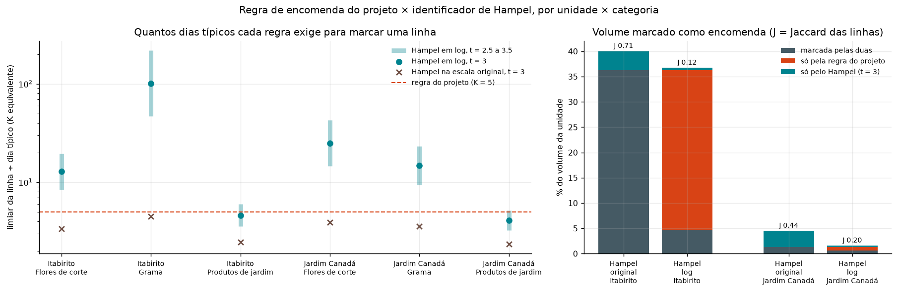

# ADR-012: Encomendas grandes fora da série do L1 + teto de picos no treino

**Status**: Aceito (2026-09-23)
**Autores**: Felipe Gurgel Araújo, Daniel Nunes da Silva
**Relacionado**: [ADR-011](ADR-011-escopo-previsao-sem-reposicao.md) (L1 por unidade),
[ADR-010](ADR-010-exogenas-nominais-fora-do-l1.md) (`pagamento`/cliente não são exógenas),
`docs/prediction/00-eda_report.md` §3.7 e §3.12, `docs/prediction/01-pre_processing.md` §6,
código em `training_scripts/preprocessing/encomendas.py` e `training_scripts/eda/eda_encomendas.py`

---

## Contexto

O L1 ajusta um SARIMAX na venda diária de cada unidade ([ADR-011](ADR-011-escopo-previsao-sem-reposicao.md)).
No EDA de 2026-09-21, **Itabirito ficou com MASE 1,434** no walk-forward (26 janelas de
14 dias). Isso é pior do que repetir a semana anterior (naïve sazonal) e reprova o limiar
da constituição (`MASE < 1.0`). Jardim Canadá ficou em 0,659.

A causa aparece no nível da linha de venda, não da série:

| | Itabirito | Jardim Canadá |
| --- | --- | --- |
| Grama vendida num dia típico (mediana, dias com venda) | 203 m² | 1.403 m² |
| Maior linha de venda individual de Grama | 20.000 m² | 15.000 m² |
| Parte do volume de Grama nos 10 maiores dias | 43,6% | 8,6% |
| CV da série diária da unidade | 2,40 | 1,02 |

Em Itabirito, **um cliente** responde por 32 das 40 maiores linhas de Grama. Todas são
faturadas por boleto, que é o perfil de obra/paisagismo (B2B), não de balcão. A série da
unidade soma duas demandas de natureza diferente:

- **Balcão**: muitas linhas pequenas, quase sempre de "CONSUMIDOR" no ERP. Segue o
  calendário (dia da semana, datas comemorativas) e é o que o SARIMAX consegue prever.
- **Encomenda**: poucas linhas enormes, em datas sem padrão de calendário. É combinada
  com antecedência com o cliente e não sai do estoque de prateleira.

Nenhum modelo de série temporal antecipa um pedido de 20.000 m² num dia de 200 m². Um pico
desses também contamina o ajuste: puxa o nível, infla a variância e distorce os
coeficientes (Chen; Liu, 1993b).

## Decisão

A série que o L1 prevê passa a ser a **venda de balcão**, obtida em duas camadas aplicadas
nesta ordem.

### 1. Separar as encomendas

Uma linha de venda (documento × produto) é **encomenda** quando sua quantidade, sozinha,
supera **K = 5 dias típicos** da própria `unidade × categoria`:

```text
limiar(unidade, categoria) = K × mediana( volume diário em dias com venda, seg–sáb )
encomenda = qtdade_da_linha > limiar
```

- As linhas de encomenda saem da série do L1 e formam um **fluxo à parte**. Esse fluxo não
  é previsto estatisticamente: é demanda sob pedido, e o sinal útil para ela é a carteira
  de pedidos combinada com o cliente, não o histórico.
- O limiar é calculado **só com o treino**: em produção, com o histórico até a data do
  ajuste; no walk-forward, com o que existia antes de cada janela. Assim não há vazamento.
- A regra usa apenas `qtdade`, `unidade`, `categoria` e `data`, colunas que já sobrevivem
  ao `reduce_schema`. Cliente e forma de pagamento **não** entram na regra, só serviram de
  evidência no EDA (ADR-010 continua valendo).

**Por que um múltiplo do dia típico, e não um percentil das linhas.** Em Produtos de
jardim, linhas de 60 a 100 mudas são rotina. O 99º percentil das linhas marcaria 37–48%
do volume como encomenda, quase tudo compra legítima de balcão. O múltiplo da mediana
diária pergunta outra coisa: "esta linha sozinha vale quantos dias normais da loja?". Usa
a mediana como centro pelo mesmo motivo dos critérios robustos de outlier: a média seria
puxada pelas próprias encomendas (Leys et al., 2013). E calcula o limiar dentro de cada
`unidade × categoria` porque o que é anômalo depende do contexto (Chandola; Banerjee;
Kumar, 2009): 1.000 m² é rotina na Grama de Jardim Canadá e são 5 dias de venda na de
Itabirito. A regra **não é** o filtro de Hampel, que mede a distância à mediana em
múltiplos do MAD (mediana + t × MAD; Hampel, 1974; Pearson et al., 2016). Comparada com
ele, fica contida no identificador clássico: ver "Comparação com o identificador de
Hampel", abaixo.

### 2. Aplicar teto aos picos que restam

Na série de balcão do treino, dias acima do **99º percentil dos dias abertos** são
rebaixados a esse valor (winsorização) antes do ajuste. Só o treino é alterado; o erro
continua medido na série real.

## Evidência (EDA 6 — `eda_encomendas.py`, 2026-09-23)

**Quem a regra separa:**

| | Itabirito | Jardim Canadá |
| --- | --- | --- |
| Linhas de encomenda | 80 (em 58 dias) | 14 (em 9 dias) |
| Parte do volume | **36,3%** | 1,3% |
| Linhas pagas por boleto: encomenda × balcão | **65,0% × 1,4%** | 7,1% × 3,6% |
| Linhas de "CONSUMIDOR": encomenda × balcão | 7,5% × 90,5% | 21,4% × 74,2% |
| Clientes distintos nas encomendas (maior deles) | 25 (70,7% do volume) | 7 (43,1%) |
| CV: total → balcão → balcão com teto | 2,40 → 1,25 → 1,11 | 1,02 → 1,00 → 0,84 |

**Efeito no erro** (MASE, 26 janelas de 14 dias, limiar e teto recalculados em cada janela):

| Variante | Itabirito SARIMAX | Itabirito Holt-Winters | Jardim Canadá SARIMAX | Jardim Canadá Holt-Winters |
| --- | --- | --- | --- | --- |
| Original (total → total) | 1,434 | 1,311 | 0,659 | 0,727 |
| Só teto | 1,401 | 1,283 | 0,648 | 0,713 |
| Só separar | 0,810 | 0,699 | 0,656 | 0,724 |
| **Separar + teto (decisão)** | **0,796** | **0,688** | **0,646** | **0,710** |

**Sensibilidade a K** (SARIMAX, separar + teto): Itabirito fica em 0,795, 0,796 e 0,789
com K = 3, 5 e 10; Jardim Canadá em 0,657, 0,646 e 0,640. A conclusão não depende da
escolha exata de K.

### Comparação com o identificador de Hampel (EDA 7 — `eda_encomendas_hampel.py`, 2026-10-08)

Nenhum trabalho publicado usa o limiar "K dias típicos". Para ancorá-lo num critério da
literatura, o EDA 7 aplicou o identificador de Hampel (marca quando o valor passa de
mediana + t × 1,4826 × MAD; Hampel, 1974; Pearson et al., 2016) ao **mesmo contexto**: a
mesma amostra do dia típico (volume diário da `unidade × categoria`, dias com venda,
seg–sáb), aplicado a cada linha. Limiares da base inteira, só descritivos. Três versões:
na escala original (o identificador clássico), em escala log e sobre a distribuição das
próprias linhas. O "K equivalente" é o limiar ÷ dia típico.

| Par | Dia típico | Projeto (K = 5) | Hampel original, t = 3 | Hampel em log, t = 3 |
| --- | --- | --- | --- | --- |
| Itabirito · Grama | 203 | 1.015 | 911 (K 4,5) | 20.536 (K 101) |
| Itabirito · Produtos de jardim | 616 | 3.079 | 1.516 (K 2,5) | 2.847 (K 4,6) |
| Itabirito · Flores de corte | 31 | 155 | 104 (K 3,4) | 397 (K 12,8) |
| Jardim Canadá · Grama | 1.403 | 7.014 | 4.989 (K 3,6) | 20.736 (K 14,8) |
| Jardim Canadá · Produtos de jardim | 1.653 | 8.265 | 3.895 (K 2,4) | 6.769 (K 4,1) |
| Jardim Canadá · Flores de corte | 32 | 160 | 125 (K 3,9) | 801 (K 25,0) |

| | Projeto | Hampel original, t = 3 | Hampel em log, t = 3 |
| --- | --- | --- | --- |
| Itabirito: linhas marcadas | 80 | 112 (as 80 do projeto + 32) | 12 (10 em comum) |
| Itabirito: % do volume | 36,3% | 40,1% | 5,2% |
| Itabirito: % pagas por boleto (balcão: 1,4%) | 65,0% | 56,2% | 50,0% |
| Jardim Canadá: linhas marcadas | 14 | 32 (as 14 do projeto + 18) | 4 (3 em comum) |
| Jardim Canadá: % do volume | 1,3% | 4,5% | 0,9% |
| Jaccard das linhas com o projeto (ITA · JC) | — | 0,71 · 0,44 | 0,12 · 0,20 |



Leitura:

- **A regra do projeto está contida no identificador de Hampel clássico.** Nas 6
  combinações, toda linha marcada pela regra também é outlier pelo Hampel na escala
  original com t = 3. A regra é um corte mais conservador do mesmo critério: exige 5 dias
  típicos, onde o Hampel exigiria de 2,4 a 4,5.
- **Onde as encomendas se concentram, as duas quase coincidem**: Grama de Itabirito, 68 ×
  71 linhas; Flores de corte de Jardim Canadá, 12 × 14.
- **As 50 linhas que só o Hampel marca** (32 em Itabirito, 18 em Jardim Canadá; 3 a 4
  pontos do volume, a maioria em Produtos de jardim) têm perfil intermediário. Em
  Itabirito, 34% são pagas por boleto (65% nas encomendas do projeto, 1,4% no balcão) e só
  12,5% são de "CONSUMIDOR" (90,5% no balcão). São vendas grandes de clientes
  identificados, próximas das "vendas médias" da Etapa 5. A regra do projeto as deixa no
  balcão, onde o teto p99 atenua os dias mais extremos.
- **Em escala log, o Hampel não serve aqui.** A dispersão do volume diário em log é muito
  grande em Grama e Flores de corte: em Grama de Itabirito, o limiar iria a 20.536 m²
  (101 dias típicos) e nenhuma linha seria marcada. Em Itabirito, as 70 linhas que só o
  projeto marca (68 delas de Grama) têm 68,6% pagas por boleto, o perfil de encomenda. O
  Hampel em log só concorda com o projeto em Produtos de jardim (K equivalente 4,1 a 4,6).
- **Sobre as próprias linhas, o Hampel degenera.** Em Flores de corte e Produtos de jardim
  a maioria das linhas tem 1 unidade, o MAD vira 0 e o limiar cai a 1 unidade: em
  Itabirito marcaria 51.865 linhas (75% do volume). Confirma o argumento acima: a
  referência tem de ser o volume diário do par, não a distribuição das linhas.

**Conclusão:** o limiar K × dia típico é uma versão mais conservadora do identificador de
Hampel aplicado ao volume diário de cada `unidade × categoria`. Com isso, a escolha de K = 5
deixa de ser um número solto: fica acima do K equivalente do Hampel clássico em todos os
pares, e a sensibilidade a K (acima) mostra que a previsão não muda entre 3 e 10.

### Antes × depois

**Por unidade.** "Antes" é a série total que o L1 usava. "Depois" é a
série de balcão, sem as encomendas, com e sem o teto. As características da série vêm do
mesmo diagnóstico do EDA 2 (`eda_series.analisa_serie`). O erro de previsão vem das 26
janelas de 14 dias. Na coluna "com teto", o erro é medido contra a venda de balcão real,
já que o teto só altera o treino.

*Itabirito*

| Indicador | Antes (total) | Depois: balcão | Depois: balcão + teto |
| --- | --- | --- | --- |
| Veredito do diagnóstico para SARIMAX | atenção | **ok** | **ok** |
| Venda média por dia | 1.677 | 1.069 | 1.043 |
| Variação diária (CV) | 2,39 | 1,25 | 1,11 |
| Maior dia ÷ média | 37,2 | 13,4 | 7,2 |
| Curtose (peso da cauda) | 82,6 | 29,0 | 12,7 |
| Força do ciclo semanal (0 a 1) | 0,07 | 0,20 | 0,24 |
| Tendência | +54%/ano | +8%/ano | +10%/ano |
| Média dos primeiros → últimos 90 dias | 892 → 3.033 | 774 → 910 | 773 → 910 |
| CV² dos dias com venda (classe de demanda) | 4,58 (errática) | 1,11 (errática) | 0,84 (errática) |
| **MASE SARIMAX** | **1,434** | 0,810 | **0,796** |
| WAPE SARIMAX | 91,6% | 62,4% | 61,3% |
| Erro acumulado em 14 dias, SARIMAX (média absoluta) | 47,4% | 32,2% | 30,4% |
| MASE suavização exponencial (Holt-Winters) | 1,311 | 0,699 | 0,688 |
| WAPE suavização exponencial | 84,4% | 53,8% | 53,0% |

*Jardim Canadá*

| Indicador | Antes (total) | Depois: balcão | Depois: balcão + teto |
| --- | --- | --- | --- |
| Veredito do diagnóstico para SARIMAX | ok | ok | ok |
| Venda média por dia | 3.317 | 3.273 | 3.191 |
| Variação diária (CV) | 1,01 | 1,00 | 0,84 |
| Maior dia ÷ média | 13,9 | 14,1 | 4,4 |
| Curtose (peso da cauda) | 40,2 | 43,9 | 2,7 |
| Força do ciclo semanal (0 a 1) | 0,25 | 0,25 | 0,38 |
| Tendência | −13%/ano | −13%/ano | −8%/ano |
| CV² dos dias com venda (classe de demanda) | 0,67 (errática) | 0,64 (errática) | 0,40 (**suave**) |
| **MASE SARIMAX** | **0,659** | 0,656 | **0,646** |
| WAPE SARIMAX | 47,3% | 46,7% | 46,0% |
| Erro acumulado em 14 dias, SARIMAX (média absoluta) | 27,7% | 27,0% | 25,4% |
| MASE suavização exponencial (Holt-Winters) | 0,727 | 0,724 | 0,710 |
| WAPE suavização exponencial | 52,2% | 51,6% | 50,6% |

Leitura do antes × depois:

- **Itabirito muda de natureza.** Tirar as encomendas corta a variação diária pela metade
  (CV 2,39 → 1,25) e reduz o peso da cauda de 82,6 para 29,0. O ciclo semanal, que estava
  escondido pelos picos, fica três vezes mais forte (0,07 → 0,20), e é justamente o que o
  SARIMAX usa para prever. Por isso o veredito passa de "atenção" para "ok" e o erro
  percentual (WAPE) cai de 92% para 61%.
- **Em Jardim Canadá, quem ajuda é o teto, não a separação.** Quase não há encomenda ali. O
  teto reduz o maior dia de 14 para 4,4 vezes a média e torna a série "suave" na
  classificação de demanda (CV² < 0,49), mas o ganho de previsão é pequeno (MASE 0,659 →
  0,646).
- **A tendência muda de figura.** Em Itabirito, os +54%/ano eram quase todos encomenda: a
  média dos últimos 90 dias do balcão (910) é só 18% maior que a dos primeiros 90 (774).

**Leitura do teste por variante:**

- **A separação faz quase todo o trabalho.** Itabirito passa de 1,434 para 0,810 e fica
  abaixo de 1 com os dois previsores. O teto sozinho mal ajuda (1,434 → 1,401), porque
  winsorizar o total não remove pedidos que são um terço do volume. Depois da separação, o
  teto acrescenta 1–2%.
- **Jardim Canadá quase não muda** (0,659 → 0,646), o esperado para uma unidade em que
  encomendas são 1,3% do volume. A regra não estraga a série que já estava boa.
- **A "tendência" de Itabirito era, em boa parte, encomenda.** Sem as encomendas, o
  balcão cresce **+8%/ano** (774 → 910 unidades/dia entre os primeiros e os últimos 90
  dias), e não +54%. O volume de encomendas passou de 68 mil unidades em 2024 para 377 mil
  em 2025.

## Consequências

- **Positivas**: Itabirito sai de `low_confidence` por MASE. A tendência aparente deixa de
  distorcer o SARIMAX, e a recomendação de testar `d = 1` (EDA §3.0) perde força. O
  critério é simples, auditável e usa só colunas que já existem.
- **O que não se resolve**: o sistema **não prevê encomendas**. Se a previsão do balcão for
  comparada à venda total de Itabirito, o MASE volta a 1,258, porque o erro que sobra é a
  encomenda não prevista. O painel precisa deixar isso explícito: "previsão de balcão;
  encomendas grandes não incluídas". Para cobri-las, o caminho da literatura é usar a
  informação antecipada do pedido (carteira de encomendas) em vez de extrapolar o
  histórico (Bartezzaghi; Verganti, 1995; Verganti, 1997). Isso depende de a parceira ter
  esse registro (pergunta nova no EDA §5).
- **Desagregação L2**: a participação de cada categoria e SKU passa a ser calculada sobre o
  balcão, senão uma encomenda de Grama inflaria a participação da Grama nas semanas
  seguintes.
- **Migração**: `encomendas.py` só tem funções puras (pandas), prontas para
  `backend/domain/etl/`. O limiar de cada `unidade × categoria` deve ser salvo junto com o
  artefato do modelo L1, para que a série de produção use o mesmo corte do treino.
- **Pendente com a parceira**: confirmar que essas vendas são de fato encomendas (sob
  pedido, fora do estoque de prateleira) e se existe registro prévio delas.

## Alternativas consideradas

1. **Só winsorizar o total**: testado, não resolve (1,401).
2. **Dummy de intervenção por dia de encomenda no SARIMAX** (Box; Tiao, 1975; Chen; Liu,
   1993a): corrige o ajuste, mas a dummy precisa ser conhecida no futuro para servir na
   previsão. Isso equivale a ter a carteira de pedidos, que é o caso da separação com
   informação antecipada.
3. **Modelo L1 próprio para a Grama de Itabirito**: a série continua errática sozinha
   (CV 4,49), então mexe no lugar errado.
4. **Aceitar `low_confidence`**: permitido pela constituição, mas desnecessário diante de
   uma causa identificada e tratável.

## Referências

As referências abaixo foram confirmadas em bases bibliográficas (Crossref, páginas das
editoras). Onde só o resumo foi lido, isso está indicado. **Nenhum trabalho encontrado usa
exatamente o limiar "K dias típicos"**: ele é uma escolha metodológica deste projeto,
apoiada nas referências.

*Separar pedidos grandes / demanda heterogênea (camada 1):*

- BARTEZZAGHI, E.; VERGANTI, R. Managing demand uncertainty through order overplanning.
  *International Journal of Production Economics*, v. 40, n. 2-3, p. 107-120, 1995.
  DOI: 10.1016/0925-5273(95)00047-8. Mostra que, para demanda irregular, técnicas baseadas
  só no histórico funcionam mal e a informação antecipada dos pedidos dos clientes deve ser
  usada. (resumo)
- BARTEZZAGHI, E.; VERGANTI, R.; ZOTTERI, G. A simulation framework for forecasting
  uncertain lumpy demand. *International Journal of Production Economics*, v. 59, n. 1-3,
  p. 499-510, 1999. DOI: 10.1016/S0925-5273(98)00012-7. Atribui a demanda *lumpy* à
  heterogeneidade dos clientes (poucos clientes grandes e diferentes entre si) e compara
  previsão por histórico com técnicas por pedido. (resumo)
- VERGANTI, R. Order overplanning with uncertain lumpy demand: a simplified theory.
  *International Journal of Production Research*, v. 35, n. 12, p. 3229-3248, 1997.
  Formaliza o planejamento por pedido/cliente a partir da informação antecipada do
  processo de compra. (citação confirmada em fonte secundária; DOI não confirmado)
- KALCHSCHMIDT, M.; ZOTTERI, G.; VERGANTI, R. Inventory management in a multi-echelon
  spare parts supply chain. *International Journal of Production Economics*, v. 81-82,
  p. 397-413, 2003. DOI: 10.1016/S0925-5273(02)00284-0. Descrito na literatura como a
  separação da demanda regular da demanda irregular gerada por poucos clientes grandes,
  cada uma com a sua técnica. É o trabalho mais próximo desta decisão. (descrição de
  fontes secundárias; conferir o texto completo antes de citar no artigo)
- KALCHSCHMIDT, M.; VERGANTI, R.; ZOTTERI, G. Forecasting demand from heterogeneous
  customers. *International Journal of Operations & Production Management*, v. 26, n. 6,
  p. 619-638, 2006. DOI: 10.1108/01443570610666975. Segmenta clientes por padrão de demanda
  e prevê cada segmento com um método próprio (por agrupamento, não por limiar de
  tamanho). (resumo)
- JOHNSTON, F. R.; BOYLAN, J. E.; SHALE, E. A. An examination of the size of orders from
  customers, their characterisation and the implications for inventory control of slow
  moving items. *Journal of the Operational Research Society*, v. 54, n. 8, p. 833-837,
  2003. DOI: 10.1057/palgrave.jors.2601586. Mostra, em ~500 mil linhas de pedido, que o
  tamanho do pedido tem cauda longa e deve ser analisado no nível da linha. (resumo)
- OLHAGER, J. Strategic positioning of the order penetration point. *International Journal
  of Production Economics*, v. 85, n. 3, p. 319-329, 2003. Justifica tratar parte da
  demanda como sob pedido (*make-to-order*), fora da política de estoque. (resumo)

*Picos e outliers na série (camada 2):*

- HYNDMAN, R. J.; ATHANASOPOULOS, G. *Forecasting: principles and practice*. 3. ed.
  Melbourne: OTexts, 2021. Seção 13.9. Disponível em: https://otexts.com/fpp3/. Detecta
  outliers por limites de quantis/IQR e alerta que substituí-los sem entender a causa é
  perigoso. Por isso as encomendas viram um fluxo próprio, em vez de serem apagadas.
  (texto lido)
- CHEN, C.; LIU, L.-M. Joint estimation of model parameters and outlier effects in time
  series. *Journal of the American Statistical Association*, v. 88, n. 421, p. 284-297,
  1993a. DOI: 10.1080/01621459.1993.10594321. (resumo)
- CHEN, C.; LIU, L.-M. Forecasting time series with outliers. *Journal of Forecasting*,
  v. 12, n. 1, p. 13-35, 1993b. DOI: 10.1002/for.3980120103. Outliers distorcem os
  parâmetros e alargam os intervalos de previsão do ARIMA. (resumo)
- BOX, G. E. P.; TIAO, G. C. Intervention analysis with applications to economic and
  environmental problems. *Journal of the American Statistical Association*, v. 70,
  n. 349, p. 70-79, 1975. DOI: 10.1080/01621459.1975.10480264. (resumo)
- PEARSON, R. K.; NEUVO, Y.; ASTOLA, J.; GABBOUJ, M. Generalized Hampel filters. *EURASIP
  Journal on Advances in Signal Processing*, v. 2016, art. 87, 2016.
  DOI: 10.1186/s13634-016-0383-6. Filtro robusto que marca o valor cuja distância à
  mediana passa de t × MAD. Não é o mesmo critério do limiar K × mediana (que mede a
  distância em múltiplos da própria mediana), mas a regra do projeto fica contida nele
  (EDA 7). (resumo)
- HAMPEL, F. R. The influence curve and its role in robust estimation. *Journal of the
  American Statistical Association*, v. 69, n. 346, p. 383-393, 1974.
  DOI: 10.1080/01621459.1974.10482962. Origem do identificador de Hampel (mediana e MAD
  como centro e escala robustos). (metadados conferidos no Crossref em 2026-10-08; texto
  não lido)
- LEYS, C.; LEY, C.; KLEIN, O.; BERNARD, P.; LICATA, L. Detecting outliers: do not use
  standard deviation around the mean, use absolute deviation around the median. *Journal
  of Experimental Social Psychology*, v. 49, n. 4, p. 764-766, 2013.
  DOI: 10.1016/j.jesp.2013.03.013. Por que o centro tem de ser a mediana: a média e o
  desvio-padrão são puxados pelos próprios outliers. (metadados conferidos no Crossref em
  2026-10-08; texto não lido)
- CHANDOLA, V.; BANERJEE, A.; KUMAR, V. Anomaly detection: a survey. *ACM Computing
  Surveys*, v. 41, n. 3, art. 15, p. 1-58, 2009. DOI: 10.1145/1541880.1541882. Define
  anomalia contextual (um valor só é anômalo em relação ao seu contexto), o que sustenta
  calcular o limiar por `unidade × categoria`. (metadados conferidos no Crossref em
  2026-10-08; texto não lido)
