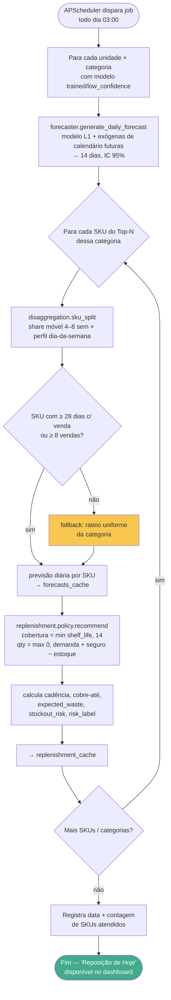

# Diagramas de Atividades — Sistema de Previsão de Estoque

> Diagrama 2 de 5. Ver índice em [`README.md`](README.md).

Este arquivo contém três diagramas de atividades (Mermaid `flowchart`), cobrindo os
fluxos operacionais centrais do sistema, conforme SPECS.md §1.2 (fluxo ponta a ponta),
§10 (agendamento) e [ADR-009](../prediction/ADR-009-granularidade-diaria-e-reposicao.md)
(arquitetura hierárquica L1 → L2 → L3).

---

## (a) Fluxo de Upload → ETL → Reajuste

Cobre US1 (Upload de Planilha) e o fluxo descrito em SPECS.md §4.4
(`upload_service.process_upload`).

```mermaid
flowchart TD
    A([Início: gestora seleciona<br/>arquivo .xlsx no dashboard]) --> B[/POST /api/v1/upload<br/>multipart/form-data/]
    B --> C{Arquivo é .xlsx/.xlsm<br/>e ≤ 50 MB?}
    C -- não --> C1[Retorna erro 400/413<br/>em PT-BR] --> Z1([Fim — usuário corrige e reenvia])
    C -- sim --> D[parser.parse_xlsx<br/>XLSX → records + skipped]
    D --> E{Estrutura reconhecida?<br/>possui campos obrigatórios}
    E -- não --> E1[Retorna erro 422<br/>'estrutura não reconhecida'] --> Z1
    E -- sim --> F[normalizer.normalize_records<br/>cast tipos, strip, remove qtdade≤0]
    F --> G[deduplicator.deduplicate<br/>chave: doc_numero + produto_cod +<br/>emissao + qtdade + vl_total]
    G --> H[file_manager.append_to_csv<br/>contas_a_receber.csv]
    H --> I[file_manager.log_processing<br/>grava processing_log]
    I --> J["Retorna UploadResponse<br/>(rows_added, rows_skipped, rows_duplicate)"]
    J --> K{retrain_scheduled?}
    K -- sim --> L[retrain_service.schedule_async_retrain<br/>dispara reajuste L1 em background]
    L --> M[Pipeline L1 por unidade × categoria<br/>ver diagrama (b)]
    M --> N[model_registry.save_artifact<br/>persiste ordem, MASE/RMSSE, status]
    N --> O[Invalida forecasts_cache +<br/>replenishment_cache]
    O --> P([Fim — modelos atualizados;<br/>previsão/reposição regeneradas na<br/>próxima rodada diária — ver (c)])
    K -- não --> P

    style C1 fill:#f94144,color:#fff
    style E1 fill:#f94144,color:#fff
    style J fill:#90be6d
    style P fill:#43aa8b,color:#fff
```

**Notas de rastreabilidade**: FR-001, FR-002, FR-011 (log de upload/retrain), RNF-02
(rastreabilidade), SC-001 (confirmação em <30s).

---

## (b) Fluxo de Reajuste Semanal dos Modelos L1

Cobre FR-005 e SPECS.md §10 (`weekly_retrain.py` + `retrain_service.py`). Ajusta um
SARIMAX por `unidade × categoria` sobre a série **diária agregada**.

```mermaid
flowchart TD
    A([APScheduler dispara job<br/>toda segunda-feira 02:00]) --> B[RetrainService.run_full_retrain<br/>trigger='scheduled']
    B --> C[Carrega contas_a_receber.csv<br/>completo]
    C --> D[Agrupa por unidade × categoria]
    D --> E{Para cada<br/>unidade × categoria}
    E --> F[prepare_daily_series<br/>soma diária, freq='D', reindex completo]
    F --> G{len(série) ≥<br/>MIN_OBSERVATIONS_DAYS=180?}
    G -- não --> G1[status = insufficient_data<br/>categoria sem previsão]
    G1 --> O
    G -- sim --> H[build_calendar_exogenous<br/>dia-da-semana, feriados, dias-até-data-comemorativa]
    H --> I[compute_rf_importance +<br/>weight_features clip 0.1]
    I --> J[suggest_d via ADF/KPSS →<br/>select_sarimax_order grid AIC<br/>D=0, m=7]
    J --> K[fit_sarimax]
    K --> L[walk_forward_cv<br/>≥4 folds, origem móvel, h=14d<br/>→ MASE, RMSSE, cobertura IC]
    L --> M[residual_tests<br/>Ljung-Box + Shapiro-Wilk]
    M --> M1{MASE < 1.0 E cobertura ∈ [90,98]<br/>E simulação de reposição<br/>melhor que regra ingênua 7d?}
    M1 -- sim --> M2[status = trained]
    M1 -- não --> M3[status = low_confidence<br/>previsão ainda gerada, com aviso]
    M2 --> N[model_registry.save_artifact<br/>joblib: modelo + importâncias]
    M3 --> N
    N --> O{Mais categorias?}
    O -- sim --> E
    O -- não --> P[Invalida forecasts_cache +<br/>replenishment_cache]
    P --> Q[Registra RetrainHistory<br/>started_at, finished_at, contagens]
    Q --> R([Fim — modelos L1 prontos;<br/>previsão/reposição na rodada diária (c)])

    style G1 fill:#f9c74f
    style M3 fill:#f9c74f
    style M2 fill:#90be6d
    style R fill:#43aa8b,color:#fff
```

**Notas de rastreabilidade**: exceções por categoria são capturadas e logadas
individualmente — não abortam o pipeline. RNF-03 exige que o ciclo conclua em < 2h.
Princípio III da constituição (walk-forward CV ≥4 folds + MASE < 1.0 + simulação de
reposição antes de `status = "trained"`).

---

## (c) Fluxo de Geração Diária de Previsão + Reposição

Cobre FR-003/FR-006 e SPECS.md §10 (`daily_generation.py`). Roda todo dia às 03:00, a
partir dos modelos L1 em cache — **não reajusta**, só estende o horizonte e aplica L2/L3.



**Notas de rastreabilidade**: FR-012 (log da geração diária), SC-004 (conclui em < 15min),
Princípio V (rastreabilidade — data e contagem de SKUs por rodada).
