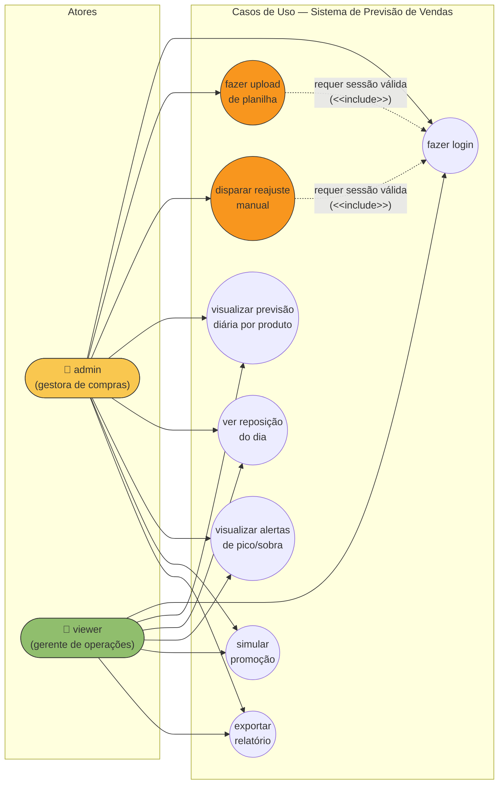

# Diagrama de Casos de Uso — Sistema de Previsão de Vendas

> Diagrama 1 de 5. Ver índice em [`README.md`](README.md).

## Visão geral

O sistema possui dois atores (perfis de usuário), conforme FR-000a da especificação
(`specs/001-sistema-previsao-vendas/spec.md`) e o Princípio VI da constituição
(segurança por padrão):

- **admin** (gestora de compras) — acesso completo: upload, retrain manual e todas as
  funcionalidades de visualização.
- **viewer** (gerente de operações) — acesso somente de leitura: previsões, alertas,
  simulação e exportação. Não pode fazer upload nem disparar retrain.

Mermaid não possui um tipo nativo de diagrama de casos de uso UML. A notação abaixo
aproxima o diagrama com um `graph LR`: nós de ator (retângulo arredondado) conectados a
nós de caso de uso (oval), com rótulos de relação (`<<include>>` onde aplicável, por
exemplo "fazer login" sendo pré-requisito implícito de todos os demais casos).

## Diagrama

## Matriz de permissão por caso de uso

| Caso de uso | admin | viewer | Rastreabilidade |
|---|---|---|---|
| Fazer login | ✅ | ✅ | US4, FR-000 |
| Fazer upload de planilha | ✅ | ❌ | US1, FR-001, FR-002 |
| Disparar reajuste manual | ✅ | ❌ | FR-005, `POST /api/v1/models/retrain` |
| Visualizar previsão diária por produto | ✅ | ✅ | US2, FR-003, FR-004 |
| Ver reposição do dia | ✅ | ✅ | US3, FR-006, `GET /api/v1/replenishment/*` |
| Visualizar alertas de pico/sobra | ✅ | ✅ | US3, FR-007 |
| Simular promoção | ✅ | ✅ | US5, FR-009 |
| Exportar relatório | ✅ | ✅ | US6, FR-010 |

Os casos de uso restritos a **admin** (upload e retrain manual) implementam o
Princípio VI (Segurança por padrão) da constituição do projeto e o requisito FR-000a:
tentativas de `viewer` retornam `403 Forbidden` com a mensagem
`"Você não tem permissão para esta ação."` (ver `SPECS.md` §7.0).
